# Ordo parish storage ERD

<!-- Generated from the authoritative migrations by `crates/storage/src/erd.rs`; do not edit by hand. -->

This is the physical schema the bundled migrations create: the Mermaid
overview lists every table and foreign-key relationship, and each table
section records its columns, constraints, indexes, ownership, and lifecycle.

Regenerate with `ORDO_BLESS_ERD=1 cargo test -p storage erd`.

## Physical overview

```mermaid
erDiagram
    arrangement {
        TEXT id PK
        TEXT song_id FK
        TEXT title
        TEXT created_at
    }
    arrangement_choir {
        TEXT id PK
        TEXT arrangement_id FK
        TEXT choir_id FK
        TEXT created_at
    }
    arrangement_language {
        TEXT id PK
        TEXT arrangement_id FK
        TEXT language
        TEXT created_at
    }
    arrangement_occasion {
        TEXT id PK
        TEXT arrangement_id FK
        TEXT occasion
        TEXT created_at
    }
    arrangement_section {
        TEXT id PK
        TEXT arrangement_id FK
        TEXT title
        TEXT body
        TEXT created_at
    }
    celebration_package {
        TEXT id PK
        TEXT created_at
    }
    choir {
        TEXT id PK
        TEXT name
        TEXT created_at
    }
    edit_revision {
        TEXT id PK
        TEXT entity_kind
        TEXT entity_id
        TEXT parent_id FK
        TEXT content_hash
        TEXT created_at
    }
    managed_asset {
        TEXT id PK
        TEXT sha256
        INTEGER byte_len
        TEXT media_type
        TEXT created_at
    }
    ordo_migrations {
        INTEGER id PK
        TEXT name
        TEXT checksum
        TEXT applied_at
    }
    parish {
        TEXT id PK
        TEXT name
        TEXT created_at
        INTEGER singleton
    }
    parish_backup {
        TEXT id PK
        TEXT created_at
    }
    parish_note {
        INTEGER id PK
        INTEGER profile_id FK
        TEXT body
    }
    parish_profile {
        INTEGER id PK
        TEXT name
    }
    parish_setting {
        TEXT id PK
        TEXT setting_key
        TEXT setting_value
        TEXT created_at
    }
    presentation_snapshot {
        TEXT id PK
        TEXT created_at
    }
    schema_metadata {
        TEXT format_name PK
        INTEGER format_version
    }
    section_occurrence {
        TEXT id PK
        TEXT arrangement_id FK
        TEXT section_id FK
        INTEGER position
        TEXT created_at
    }
    song {
        TEXT id PK
        TEXT title
        TEXT created_at
    }
    song_alias {
        TEXT id PK
        TEXT song_id FK
        TEXT alias
        TEXT created_at
    }
    song_liturgical_moment {
        TEXT id PK
        TEXT song_id FK
        TEXT moment
        TEXT created_at
    }
    song_occasion {
        TEXT id PK
        TEXT song_id FK
        TEXT occasion
        TEXT created_at
    }
    theme {
        TEXT id PK
        TEXT name
        TEXT background_asset_id FK
        TEXT created_at
    }
    song ||--o{ arrangement : "song_id"
    choir ||--o{ arrangement_choir : "choir_id"
    arrangement ||--o{ arrangement_choir : "arrangement_id"
    arrangement ||--o{ arrangement_language : "arrangement_id"
    arrangement ||--o{ arrangement_occasion : "arrangement_id"
    arrangement ||--o{ arrangement_section : "arrangement_id"
    edit_revision ||--o{ edit_revision : "parent_id"
    parish_profile ||--o{ parish_note : "profile_id"
    arrangement_section ||--o{ section_occurrence : "section_id, arrangement_id"
    song ||--o{ song_alias : "song_id"
    song ||--o{ song_liturgical_moment : "song_id"
    song ||--o{ song_occasion : "song_id"
    managed_asset ||--o{ theme : "background_asset_id"
```

## Tables

### `arrangement`

- **Ownership:** T2.1 parish foundation; the Song Library (T2.3) owns Arrangement behavior.
- **Lifecycle:** Belongs to one Song work. Archived rather than deleted while history references it (Decision 43).

| Column | Type | Null | Default | Key |
| --- | --- | --- | --- | --- |
| `id` | TEXT | no | (none) | PK |
| `song_id` | TEXT | no | (none) |  |
| `title` | TEXT | no | (none) |  |
| `created_at` | TEXT | no | (none) |  |

**Checks**

- `length(id) = 36 AND id NOT GLOB '*[^0-9a-f-]*' AND length(replace(id, '-', '')) = 32 AND substr(id, 9, 1) = '-' AND substr(id, 14, 1) = '-' AND substr(id, 15, 1) = '4' AND substr(id, 19, 1) = '-' AND substr(id, 20, 1) IN ('8', '9', 'a', 'b') AND substr(id, 24, 1) = '-'`
- `created_at GLOB '[0-9][0-9][0-9][0-9]-[0-1][0-9]-[0-3][0-9]T[0-2][0-9]:[0-5][0-9]:[0-5][0-9].[0-9][0-9][0-9]Z'`

**Indexes**

| Name | Unique | Origin | Columns |
| --- | --- | --- | --- |
| `arrangement_song_id_idx` | no | created | `song_id` |
| `sqlite_autoindex_arrangement_1` | yes | primary key | `id` |

**Foreign keys**

| Columns | References | On delete |
| --- | --- | --- |
| `song_id` | `song`(`id`) | RESTRICT |

### `arrangement_choir`

- **Ownership:** T2.1 parish foundation; the Song Library owns Choir applicability.
- **Lifecycle:** Many-to-many link between an Arrangement and the Choirs that share that exact rendition.

| Column | Type | Null | Default | Key |
| --- | --- | --- | --- | --- |
| `id` | TEXT | no | (none) | PK |
| `arrangement_id` | TEXT | no | (none) |  |
| `choir_id` | TEXT | no | (none) |  |
| `created_at` | TEXT | no | (none) |  |

**Checks**

- `length(id) = 36 AND id NOT GLOB '*[^0-9a-f-]*' AND length(replace(id, '-', '')) = 32 AND substr(id, 9, 1) = '-' AND substr(id, 14, 1) = '-' AND substr(id, 15, 1) = '4' AND substr(id, 19, 1) = '-' AND substr(id, 20, 1) IN ('8', '9', 'a', 'b') AND substr(id, 24, 1) = '-'`
- `created_at GLOB '[0-9][0-9][0-9][0-9]-[0-1][0-9]-[0-3][0-9]T[0-2][0-9]:[0-5][0-9]:[0-5][0-9].[0-9][0-9][0-9]Z'`

**Indexes**

| Name | Unique | Origin | Columns |
| --- | --- | --- | --- |
| `arrangement_choir_choir_id_idx` | no | created | `choir_id` |
| `sqlite_autoindex_arrangement_choir_1` | yes | primary key | `id` |
| `sqlite_autoindex_arrangement_choir_2` | yes | unique constraint | `arrangement_id`, `choir_id` |

**Foreign keys**

| Columns | References | On delete |
| --- | --- | --- |
| `choir_id` | `choir`(`id`) | RESTRICT |
| `arrangement_id` | `arrangement`(`id`) | RESTRICT |

### `arrangement_language`

- **Ownership:** T2.1 parish foundation; the Song Library owns language metadata.
- **Lifecycle:** One language tag per Arrangement. A translated rendition remains a separate Arrangement.

| Column | Type | Null | Default | Key |
| --- | --- | --- | --- | --- |
| `id` | TEXT | no | (none) | PK |
| `arrangement_id` | TEXT | no | (none) |  |
| `language` | TEXT | no | (none) |  |
| `created_at` | TEXT | no | (none) |  |

**Checks**

- `length(id) = 36 AND id NOT GLOB '*[^0-9a-f-]*' AND length(replace(id, '-', '')) = 32 AND substr(id, 9, 1) = '-' AND substr(id, 14, 1) = '-' AND substr(id, 15, 1) = '4' AND substr(id, 19, 1) = '-' AND substr(id, 20, 1) IN ('8', '9', 'a', 'b') AND substr(id, 24, 1) = '-'`
- `created_at GLOB '[0-9][0-9][0-9][0-9]-[0-1][0-9]-[0-3][0-9]T[0-2][0-9]:[0-5][0-9]:[0-5][0-9].[0-9][0-9][0-9]Z'`

**Indexes**

| Name | Unique | Origin | Columns |
| --- | --- | --- | --- |
| `arrangement_language_arrangement_id_idx` | no | created | `arrangement_id` |
| `sqlite_autoindex_arrangement_language_1` | yes | primary key | `id` |
| `sqlite_autoindex_arrangement_language_2` | yes | unique constraint | `arrangement_id`, `language` |

**Foreign keys**

| Columns | References | On delete |
| --- | --- | --- |
| `arrangement_id` | `arrangement`(`id`) | RESTRICT |

### `arrangement_occasion`

- **Ownership:** T2.1 parish foundation; the Song Library owns occasion applicability.
- **Lifecycle:** Advisory occasion tag on one Arrangement; never a liturgical restriction.

| Column | Type | Null | Default | Key |
| --- | --- | --- | --- | --- |
| `id` | TEXT | no | (none) | PK |
| `arrangement_id` | TEXT | no | (none) |  |
| `occasion` | TEXT | no | (none) |  |
| `created_at` | TEXT | no | (none) |  |

**Checks**

- `length(id) = 36 AND id NOT GLOB '*[^0-9a-f-]*' AND length(replace(id, '-', '')) = 32 AND substr(id, 9, 1) = '-' AND substr(id, 14, 1) = '-' AND substr(id, 15, 1) = '4' AND substr(id, 19, 1) = '-' AND substr(id, 20, 1) IN ('8', '9', 'a', 'b') AND substr(id, 24, 1) = '-'`
- `created_at GLOB '[0-9][0-9][0-9][0-9]-[0-1][0-9]-[0-3][0-9]T[0-2][0-9]:[0-5][0-9]:[0-5][0-9].[0-9][0-9][0-9]Z'`

**Indexes**

| Name | Unique | Origin | Columns |
| --- | --- | --- | --- |
| `arrangement_occasion_arrangement_id_idx` | no | created | `arrangement_id` |
| `sqlite_autoindex_arrangement_occasion_1` | yes | primary key | `id` |
| `sqlite_autoindex_arrangement_occasion_2` | yes | unique constraint | `arrangement_id`, `occasion` |

**Foreign keys**

| Columns | References | On delete |
| --- | --- | --- |
| `arrangement_id` | `arrangement`(`id`) | RESTRICT |

### `arrangement_section`

- **Ownership:** T2.1 parish foundation; the Arrangement editor owns section content.
- **Lifecycle:** Reusable musical or lyrical unit. Occurrences reference it, so deletion is reference-checked.

| Column | Type | Null | Default | Key |
| --- | --- | --- | --- | --- |
| `id` | TEXT | no | (none) | PK |
| `arrangement_id` | TEXT | no | (none) |  |
| `title` | TEXT | no | (none) |  |
| `body` | TEXT | no | `''` |  |
| `created_at` | TEXT | no | (none) |  |

**Checks**

- `length(id) = 36 AND id NOT GLOB '*[^0-9a-f-]*' AND length(replace(id, '-', '')) = 32 AND substr(id, 9, 1) = '-' AND substr(id, 14, 1) = '-' AND substr(id, 15, 1) = '4' AND substr(id, 19, 1) = '-' AND substr(id, 20, 1) IN ('8', '9', 'a', 'b') AND substr(id, 24, 1) = '-'`
- `created_at GLOB '[0-9][0-9][0-9][0-9]-[0-1][0-9]-[0-3][0-9]T[0-2][0-9]:[0-5][0-9]:[0-5][0-9].[0-9][0-9][0-9]Z'`

**Indexes**

| Name | Unique | Origin | Columns |
| --- | --- | --- | --- |
| `arrangement_section_arrangement_id_idx` | no | created | `arrangement_id` |
| `sqlite_autoindex_arrangement_section_1` | yes | primary key | `id` |
| `sqlite_autoindex_arrangement_section_2` | yes | unique constraint | `id`, `arrangement_id` |

**Foreign keys**

| Columns | References | On delete |
| --- | --- | --- |
| `arrangement_id` | `arrangement`(`id`) | RESTRICT |

### `celebration_package`

- **Ownership:** T2.1 placeholder for portable Celebration Packages.
- **Lifecycle:** Rows arrive with package persistence; T2.1 creates the table only.

| Column | Type | Null | Default | Key |
| --- | --- | --- | --- | --- |
| `id` | TEXT | no | (none) | PK |
| `created_at` | TEXT | no | (none) |  |

**Checks**

- `length(id) = 36 AND id NOT GLOB '*[^0-9a-f-]*' AND length(replace(id, '-', '')) = 32 AND substr(id, 9, 1) = '-' AND substr(id, 14, 1) = '-' AND substr(id, 15, 1) = '4' AND substr(id, 19, 1) = '-' AND substr(id, 20, 1) IN ('8', '9', 'a', 'b') AND substr(id, 24, 1) = '-'`
- `created_at GLOB '[0-9][0-9][0-9][0-9]-[0-1][0-9]-[0-3][0-9]T[0-2][0-9]:[0-5][0-9]:[0-5][0-9].[0-9][0-9][0-9]Z'`

**Indexes**

| Name | Unique | Origin | Columns |
| --- | --- | --- | --- |
| `sqlite_autoindex_celebration_package_1` | yes | primary key | `id` |

**Foreign keys**

- (none)

### `choir`

- **Ownership:** T2.1 parish foundation; the Choir workspace (T2.4) owns presentation.
- **Lifecycle:** Created explicitly and retained while an Arrangement references it.

| Column | Type | Null | Default | Key |
| --- | --- | --- | --- | --- |
| `id` | TEXT | no | (none) | PK |
| `name` | TEXT | no | (none) |  |
| `created_at` | TEXT | no | (none) |  |

**Checks**

- `length(id) = 36 AND id NOT GLOB '*[^0-9a-f-]*' AND length(replace(id, '-', '')) = 32 AND substr(id, 9, 1) = '-' AND substr(id, 14, 1) = '-' AND substr(id, 15, 1) = '4' AND substr(id, 19, 1) = '-' AND substr(id, 20, 1) IN ('8', '9', 'a', 'b') AND substr(id, 24, 1) = '-'`
- `created_at GLOB '[0-9][0-9][0-9][0-9]-[0-1][0-9]-[0-3][0-9]T[0-2][0-9]:[0-5][0-9]:[0-5][0-9].[0-9][0-9][0-9]Z'`

**Indexes**

| Name | Unique | Origin | Columns |
| --- | --- | --- | --- |
| `sqlite_autoindex_choir_1` | yes | primary key | `id` |

**Foreign keys**

- (none)

### `edit_revision`

- **Ownership:** T2.2 edit-safety ledger (placeholder here).
- **Lifecycle:** Append-only revision history; each row names its parent and a content hash.

| Column | Type | Null | Default | Key |
| --- | --- | --- | --- | --- |
| `id` | TEXT | no | (none) | PK |
| `entity_kind` | TEXT | no | (none) |  |
| `entity_id` | TEXT | no | (none) |  |
| `parent_id` | TEXT | yes | (none) |  |
| `content_hash` | TEXT | no | (none) |  |
| `created_at` | TEXT | no | (none) |  |

**Checks**

- `length(id) = 36 AND id NOT GLOB '*[^0-9a-f-]*' AND length(replace(id, '-', '')) = 32 AND substr(id, 9, 1) = '-' AND substr(id, 14, 1) = '-' AND substr(id, 15, 1) = '4' AND substr(id, 19, 1) = '-' AND substr(id, 20, 1) IN ('8', '9', 'a', 'b') AND substr(id, 24, 1) = '-'`
- `length(entity_id) = 36 AND entity_id NOT GLOB '*[^0-9a-f-]*' AND length(replace(entity_id, '-', '')) = 32 AND substr(entity_id, 9, 1) = '-' AND substr(entity_id, 14, 1) = '-' AND substr(entity_id, 15, 1) = '4' AND substr(entity_id, 19, 1) = '-' AND substr(entity_id, 20, 1) IN ('8', '9', 'a', 'b') AND substr(entity_id, 24, 1) = '-'`
- `parent_id IS NULL OR ( length(parent_id) = 36 AND parent_id NOT GLOB '*[^0-9a-f-]*' AND length(replace(parent_id, '-', '')) = 32 AND substr(parent_id, 9, 1) = '-' AND substr(parent_id, 14, 1) = '-' AND substr(parent_id, 15, 1) = '4' AND substr(parent_id, 19, 1) = '-' AND substr(parent_id, 20, 1) IN ('8', '9', 'a', 'b') AND substr(parent_id, 24, 1) = '-' )`
- `length(content_hash) = 64 AND content_hash NOT GLOB '*[^0-9a-f]*'`
- `created_at GLOB '[0-9][0-9][0-9][0-9]-[0-1][0-9]-[0-3][0-9]T[0-2][0-9]:[0-5][0-9]:[0-5][0-9].[0-9][0-9][0-9]Z'`

**Indexes**

| Name | Unique | Origin | Columns |
| --- | --- | --- | --- |
| `edit_revision_entity_idx` | no | created | `entity_kind`, `entity_id` |
| `edit_revision_parent_id_idx` | no | created | `parent_id` |
| `sqlite_autoindex_edit_revision_1` | yes | primary key | `id` |

**Foreign keys**

| Columns | References | On delete |
| --- | --- | --- |
| `parent_id` | `edit_revision`(`id`) | RESTRICT |

### `managed_asset`

- **Ownership:** T2.1 managed assets (T2.1c).
- **Lifecycle:** The original bytes live under `assets/<id>`; a row commits with its referencing record or not at all.

| Column | Type | Null | Default | Key |
| --- | --- | --- | --- | --- |
| `id` | TEXT | no | (none) | PK |
| `sha256` | TEXT | no | (none) |  |
| `byte_len` | INTEGER | no | (none) |  |
| `media_type` | TEXT | no | (none) |  |
| `created_at` | TEXT | no | (none) |  |

**Checks**

- `length(id) = 36 AND id NOT GLOB '*[^0-9a-f-]*' AND length(replace(id, '-', '')) = 32 AND substr(id, 9, 1) = '-' AND substr(id, 14, 1) = '-' AND substr(id, 15, 1) = '4' AND substr(id, 19, 1) = '-' AND substr(id, 20, 1) IN ('8', '9', 'a', 'b') AND substr(id, 24, 1) = '-'`
- `length(sha256) = 64 AND sha256 NOT GLOB '*[^0-9a-f]*'`
- `byte_len >= 0`
- `length(media_type) > 0`
- `created_at GLOB '[0-9][0-9][0-9][0-9]-[0-1][0-9]-[0-3][0-9]T[0-2][0-9]:[0-5][0-9]:[0-5][0-9].[0-9][0-9][0-9]Z'`

**Indexes**

| Name | Unique | Origin | Columns |
| --- | --- | --- | --- |
| `sqlite_autoindex_managed_asset_1` | yes | primary key | `id` |

**Foreign keys**

- (none)

### `ordo_migrations`

- **Ownership:** Storage migration runner (T0.7); infrastructure, not parish data.
- **Lifecycle:** Append-only checksummed history. Each row records one applied migration.

| Column | Type | Null | Default | Key |
| --- | --- | --- | --- | --- |
| `id` | INTEGER | yes | (none) | PK |
| `name` | TEXT | no | (none) |  |
| `checksum` | TEXT | no | (none) |  |
| `applied_at` | TEXT | no | (none) |  |

**Checks**

- (none)

**Indexes**

- (none)

**Foreign keys**

- (none)

### `parish`

- **Ownership:** T2.1 parish foundation; the parish store (T2.1b) owns access.
- **Lifecycle:** The single local Parish row, enforced by `singleton`; retained for the database lifetime.

| Column | Type | Null | Default | Key |
| --- | --- | --- | --- | --- |
| `id` | TEXT | no | (none) | PK |
| `name` | TEXT | no | (none) |  |
| `created_at` | TEXT | no | (none) |  |
| `singleton` | INTEGER | no | `1` |  |

**Checks**

- `length(id) = 36 AND id NOT GLOB '*[^0-9a-f-]*' AND length(replace(id, '-', '')) = 32 AND substr(id, 9, 1) = '-' AND substr(id, 14, 1) = '-' AND substr(id, 15, 1) = '4' AND substr(id, 19, 1) = '-' AND substr(id, 20, 1) IN ('8', '9', 'a', 'b') AND substr(id, 24, 1) = '-'`
- `created_at GLOB '[0-9][0-9][0-9][0-9]-[0-1][0-9]-[0-3][0-9]T[0-2][0-9]:[0-5][0-9]:[0-5][0-9].[0-9][0-9][0-9]Z'`
- `singleton = 1`

**Indexes**

| Name | Unique | Origin | Columns |
| --- | --- | --- | --- |
| `sqlite_autoindex_parish_1` | yes | primary key | `id` |
| `sqlite_autoindex_parish_2` | yes | unique constraint | `singleton` |

**Foreign keys**

- (none)

### `parish_backup`

- **Ownership:** T2.1 placeholder for portable Parish Backups.
- **Lifecycle:** Rows arrive with backup persistence; T2.1 creates the table only.

| Column | Type | Null | Default | Key |
| --- | --- | --- | --- | --- |
| `id` | TEXT | no | (none) | PK |
| `created_at` | TEXT | no | (none) |  |

**Checks**

- `length(id) = 36 AND id NOT GLOB '*[^0-9a-f-]*' AND length(replace(id, '-', '')) = 32 AND substr(id, 9, 1) = '-' AND substr(id, 14, 1) = '-' AND substr(id, 15, 1) = '4' AND substr(id, 19, 1) = '-' AND substr(id, 20, 1) IN ('8', '9', 'a', 'b') AND substr(id, 24, 1) = '-'`
- `created_at GLOB '[0-9][0-9][0-9][0-9]-[0-1][0-9]-[0-3][0-9]T[0-2][0-9]:[0-5][0-9]:[0-5][0-9].[0-9][0-9][0-9]Z'`

**Indexes**

| Name | Unique | Origin | Columns |
| --- | --- | --- | --- |
| `sqlite_autoindex_parish_backup_1` | yes | primary key | `id` |

**Foreign keys**

- (none)

### `parish_note`

- **Ownership:** T0.7 storage spike (`Storage::add_parish_note`).
- **Lifecycle:** Retained as applied migration history; T2.1 leaves the spike behavior untouched.

| Column | Type | Null | Default | Key |
| --- | --- | --- | --- | --- |
| `id` | INTEGER | yes | (none) | PK |
| `profile_id` | INTEGER | no | (none) |  |
| `body` | TEXT | no | (none) |  |

**Checks**

- (none)

**Indexes**

- (none)

**Foreign keys**

| Columns | References | On delete |
| --- | --- | --- |
| `profile_id` | `parish_profile`(`id`) | NO ACTION |

### `parish_profile`

- **Ownership:** T0.7 storage spike (`Storage::set_parish_name`); superseded by `parish`.
- **Lifecycle:** Retained as applied migration history; T2.1 leaves the spike behavior untouched.

| Column | Type | Null | Default | Key |
| --- | --- | --- | --- | --- |
| `id` | INTEGER | yes | (none) | PK |
| `name` | TEXT | no | (none) |  |

**Checks**

- `id = 1`

**Indexes**

- (none)

**Foreign keys**

- (none)

### `parish_setting`

- **Ownership:** T2.1 placeholder for parish-scoped key/value settings.
- **Lifecycle:** Rows arrive with later settings work; T2.1 does not write them.

| Column | Type | Null | Default | Key |
| --- | --- | --- | --- | --- |
| `id` | TEXT | no | (none) | PK |
| `setting_key` | TEXT | no | (none) |  |
| `setting_value` | TEXT | no | (none) |  |
| `created_at` | TEXT | no | (none) |  |

**Checks**

- `length(id) = 36 AND id NOT GLOB '*[^0-9a-f-]*' AND length(replace(id, '-', '')) = 32 AND substr(id, 9, 1) = '-' AND substr(id, 14, 1) = '-' AND substr(id, 15, 1) = '4' AND substr(id, 19, 1) = '-' AND substr(id, 20, 1) IN ('8', '9', 'a', 'b') AND substr(id, 24, 1) = '-'`
- `created_at GLOB '[0-9][0-9][0-9][0-9]-[0-1][0-9]-[0-3][0-9]T[0-2][0-9]:[0-5][0-9]:[0-5][0-9].[0-9][0-9][0-9]Z'`

**Indexes**

| Name | Unique | Origin | Columns |
| --- | --- | --- | --- |
| `sqlite_autoindex_parish_setting_1` | yes | primary key | `id` |
| `sqlite_autoindex_parish_setting_2` | yes | unique constraint | `setting_key` |

**Foreign keys**

- (none)

### `presentation_snapshot`

- **Ownership:** T2.1 placeholder for the Presentation-snapshot ledger.
- **Lifecycle:** Rows arrive with snapshot persistence; T2.1 creates the table only.

| Column | Type | Null | Default | Key |
| --- | --- | --- | --- | --- |
| `id` | TEXT | no | (none) | PK |
| `created_at` | TEXT | no | (none) |  |

**Checks**

- `length(id) = 36 AND id NOT GLOB '*[^0-9a-f-]*' AND length(replace(id, '-', '')) = 32 AND substr(id, 9, 1) = '-' AND substr(id, 14, 1) = '-' AND substr(id, 15, 1) = '4' AND substr(id, 19, 1) = '-' AND substr(id, 20, 1) IN ('8', '9', 'a', 'b') AND substr(id, 24, 1) = '-'`
- `created_at GLOB '[0-9][0-9][0-9][0-9]-[0-1][0-9]-[0-3][0-9]T[0-2][0-9]:[0-5][0-9]:[0-5][0-9].[0-9][0-9][0-9]Z'`

**Indexes**

| Name | Unique | Origin | Columns |
| --- | --- | --- | --- |
| `sqlite_autoindex_presentation_snapshot_1` | yes | primary key | `id` |

**Foreign keys**

- (none)

### `schema_metadata`

- **Ownership:** T2.1 schema-format marker.
- **Lifecycle:** Seeded with format `ordo-parish` version 1; later migrations advance the version.

| Column | Type | Null | Default | Key |
| --- | --- | --- | --- | --- |
| `format_name` | TEXT | no | (none) | PK |
| `format_version` | INTEGER | no | (none) |  |

**Checks**

- `format_version >= 1`

**Indexes**

| Name | Unique | Origin | Columns |
| --- | --- | --- | --- |
| `sqlite_autoindex_schema_metadata_1` | yes | primary key | `format_name` |

**Foreign keys**

- (none)

### `section_occurrence`

- **Ownership:** T2.1 parish foundation; the Arrangement editor owns performance order.
- **Lifecycle:** One ordered placement of a section. Several occurrences may reference one reusable section.

| Column | Type | Null | Default | Key |
| --- | --- | --- | --- | --- |
| `id` | TEXT | no | (none) | PK |
| `arrangement_id` | TEXT | no | (none) |  |
| `section_id` | TEXT | no | (none) |  |
| `position` | INTEGER | no | (none) |  |
| `created_at` | TEXT | no | (none) |  |

**Checks**

- `length(id) = 36 AND id NOT GLOB '*[^0-9a-f-]*' AND length(replace(id, '-', '')) = 32 AND substr(id, 9, 1) = '-' AND substr(id, 14, 1) = '-' AND substr(id, 15, 1) = '4' AND substr(id, 19, 1) = '-' AND substr(id, 20, 1) IN ('8', '9', 'a', 'b') AND substr(id, 24, 1) = '-'`
- `position >= 0`
- `created_at GLOB '[0-9][0-9][0-9][0-9]-[0-1][0-9]-[0-3][0-9]T[0-2][0-9]:[0-5][0-9]:[0-5][0-9].[0-9][0-9][0-9]Z'`

**Indexes**

| Name | Unique | Origin | Columns |
| --- | --- | --- | --- |
| `section_occurrence_section_id_idx` | no | created | `section_id` |
| `sqlite_autoindex_section_occurrence_1` | yes | primary key | `id` |
| `sqlite_autoindex_section_occurrence_2` | yes | unique constraint | `arrangement_id`, `position` |

**Foreign keys**

| Columns | References | On delete |
| --- | --- | --- |
| `section_id`, `arrangement_id` | `arrangement_section`(`id`, `arrangement_id`) | RESTRICT |

### `song`

- **Ownership:** T2.1 parish foundation; the Song Library (T2.3) owns Song-work behavior.
- **Lifecycle:** Canonical Song work. Archived rather than deleted while retained by history (Decision 43).

| Column | Type | Null | Default | Key |
| --- | --- | --- | --- | --- |
| `id` | TEXT | no | (none) | PK |
| `title` | TEXT | no | (none) |  |
| `created_at` | TEXT | no | (none) |  |

**Checks**

- `length(id) = 36 AND id NOT GLOB '*[^0-9a-f-]*' AND length(replace(id, '-', '')) = 32 AND substr(id, 9, 1) = '-' AND substr(id, 14, 1) = '-' AND substr(id, 15, 1) = '4' AND substr(id, 19, 1) = '-' AND substr(id, 20, 1) IN ('8', '9', 'a', 'b') AND substr(id, 24, 1) = '-'`
- `created_at GLOB '[0-9][0-9][0-9][0-9]-[0-1][0-9]-[0-3][0-9]T[0-2][0-9]:[0-5][0-9]:[0-5][0-9].[0-9][0-9][0-9]Z'`

**Indexes**

| Name | Unique | Origin | Columns |
| --- | --- | --- | --- |
| `sqlite_autoindex_song_1` | yes | primary key | `id` |

**Foreign keys**

- (none)

### `song_alias`

- **Ownership:** T2.1 parish foundation; the Song Library owns alias authoring.
- **Lifecycle:** Alias of one Song work. Never merges Songs and never rewrites the authored title.

| Column | Type | Null | Default | Key |
| --- | --- | --- | --- | --- |
| `id` | TEXT | no | (none) | PK |
| `song_id` | TEXT | no | (none) |  |
| `alias` | TEXT | no | (none) |  |
| `created_at` | TEXT | no | (none) |  |

**Checks**

- `length(id) = 36 AND id NOT GLOB '*[^0-9a-f-]*' AND length(replace(id, '-', '')) = 32 AND substr(id, 9, 1) = '-' AND substr(id, 14, 1) = '-' AND substr(id, 15, 1) = '4' AND substr(id, 19, 1) = '-' AND substr(id, 20, 1) IN ('8', '9', 'a', 'b') AND substr(id, 24, 1) = '-'`
- `created_at GLOB '[0-9][0-9][0-9][0-9]-[0-1][0-9]-[0-3][0-9]T[0-2][0-9]:[0-5][0-9]:[0-5][0-9].[0-9][0-9][0-9]Z'`

**Indexes**

| Name | Unique | Origin | Columns |
| --- | --- | --- | --- |
| `song_alias_song_id_idx` | no | created | `song_id` |
| `sqlite_autoindex_song_alias_1` | yes | primary key | `id` |
| `sqlite_autoindex_song_alias_2` | yes | unique constraint | `song_id`, `alias` |

**Foreign keys**

| Columns | References | On delete |
| --- | --- | --- |
| `song_id` | `song`(`id`) | RESTRICT |

### `song_liturgical_moment`

- **Ownership:** T2.1 parish foundation; the Song Library owns liturgical moments.
- **Lifecycle:** One liturgical-moment tag per Song work; advisory metadata only.

| Column | Type | Null | Default | Key |
| --- | --- | --- | --- | --- |
| `id` | TEXT | no | (none) | PK |
| `song_id` | TEXT | no | (none) |  |
| `moment` | TEXT | no | (none) |  |
| `created_at` | TEXT | no | (none) |  |

**Checks**

- `length(id) = 36 AND id NOT GLOB '*[^0-9a-f-]*' AND length(replace(id, '-', '')) = 32 AND substr(id, 9, 1) = '-' AND substr(id, 14, 1) = '-' AND substr(id, 15, 1) = '4' AND substr(id, 19, 1) = '-' AND substr(id, 20, 1) IN ('8', '9', 'a', 'b') AND substr(id, 24, 1) = '-'`
- `created_at GLOB '[0-9][0-9][0-9][0-9]-[0-1][0-9]-[0-3][0-9]T[0-2][0-9]:[0-5][0-9]:[0-5][0-9].[0-9][0-9][0-9]Z'`

**Indexes**

| Name | Unique | Origin | Columns |
| --- | --- | --- | --- |
| `song_liturgical_moment_song_id_idx` | no | created | `song_id` |
| `sqlite_autoindex_song_liturgical_moment_1` | yes | primary key | `id` |
| `sqlite_autoindex_song_liturgical_moment_2` | yes | unique constraint | `song_id`, `moment` |

**Foreign keys**

| Columns | References | On delete |
| --- | --- | --- |
| `song_id` | `song`(`id`) | RESTRICT |

### `song_occasion`

- **Ownership:** T2.1 parish foundation; the Song Library owns occasion applicability.
- **Lifecycle:** One advisory occasion tag per Song work; never a liturgical restriction.

| Column | Type | Null | Default | Key |
| --- | --- | --- | --- | --- |
| `id` | TEXT | no | (none) | PK |
| `song_id` | TEXT | no | (none) |  |
| `occasion` | TEXT | no | (none) |  |
| `created_at` | TEXT | no | (none) |  |

**Checks**

- `length(id) = 36 AND id NOT GLOB '*[^0-9a-f-]*' AND length(replace(id, '-', '')) = 32 AND substr(id, 9, 1) = '-' AND substr(id, 14, 1) = '-' AND substr(id, 15, 1) = '4' AND substr(id, 19, 1) = '-' AND substr(id, 20, 1) IN ('8', '9', 'a', 'b') AND substr(id, 24, 1) = '-'`
- `created_at GLOB '[0-9][0-9][0-9][0-9]-[0-1][0-9]-[0-3][0-9]T[0-2][0-9]:[0-5][0-9]:[0-5][0-9].[0-9][0-9][0-9]Z'`

**Indexes**

| Name | Unique | Origin | Columns |
| --- | --- | --- | --- |
| `song_occasion_song_id_idx` | no | created | `song_id` |
| `sqlite_autoindex_song_occasion_1` | yes | primary key | `id` |
| `sqlite_autoindex_song_occasion_2` | yes | unique constraint | `song_id`, `occasion` |

**Foreign keys**

| Columns | References | On delete |
| --- | --- | --- |
| `song_id` | `song`(`id`) | RESTRICT |

### `theme`

- **Ownership:** T2.1 placeholder carrying the first managed-asset reference (T2.1c).
- **Lifecycle:** Created with its background asset in one transaction; retained while referenced.

| Column | Type | Null | Default | Key |
| --- | --- | --- | --- | --- |
| `id` | TEXT | no | (none) | PK |
| `name` | TEXT | no | (none) |  |
| `background_asset_id` | TEXT | yes | (none) |  |
| `created_at` | TEXT | no | (none) |  |

**Checks**

- `length(id) = 36 AND id NOT GLOB '*[^0-9a-f-]*' AND length(replace(id, '-', '')) = 32 AND substr(id, 9, 1) = '-' AND substr(id, 14, 1) = '-' AND substr(id, 15, 1) = '4' AND substr(id, 19, 1) = '-' AND substr(id, 20, 1) IN ('8', '9', 'a', 'b') AND substr(id, 24, 1) = '-'`
- `background_asset_id IS NULL OR ( length(background_asset_id) = 36 AND background_asset_id NOT GLOB '*[^0-9a-f-]*' AND length(replace(background_asset_id, '-', '')) = 32 AND substr(background_asset_id, 9, 1) = '-' AND substr(background_asset_id, 14, 1) = '-' AND substr(background_asset_id, 15, 1) = '4' AND substr(background_asset_id, 19, 1) = '-' AND substr(background_asset_id, 20, 1) IN ('8', '9', 'a', 'b') AND substr(background_asset_id, 24, 1) = '-' )`
- `created_at GLOB '[0-9][0-9][0-9][0-9]-[0-1][0-9]-[0-3][0-9]T[0-2][0-9]:[0-5][0-9]:[0-5][0-9].[0-9][0-9][0-9]Z'`

**Indexes**

| Name | Unique | Origin | Columns |
| --- | --- | --- | --- |
| `sqlite_autoindex_theme_1` | yes | primary key | `id` |
| `theme_background_asset_id_idx` | no | created | `background_asset_id` |

**Foreign keys**

| Columns | References | On delete |
| --- | --- | --- |
| `background_asset_id` | `managed_asset`(`id`) | RESTRICT |

