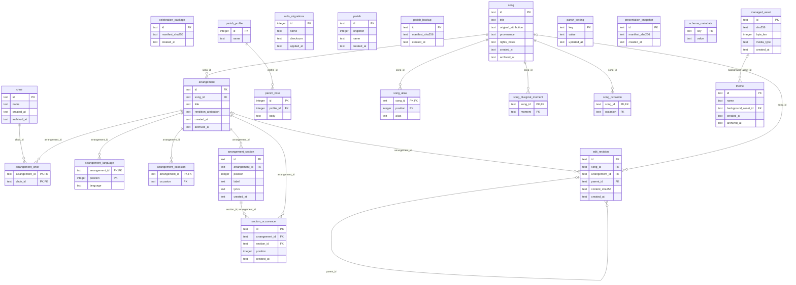

# Ordo parish database ERD

<!-- Generated by `crates/storage/src/erd.rs` from the bundled migrations.
     Do not edit by hand: run `ORDO_BLESS_ERD=1 cargo test -p storage erd`
     and commit the result. Domain meaning lives in CONTEXT.md. -->

Schema version: 3 (`0003_parish_foundation`).

## Overview

## arrangement

**Owner:** Song Library. **Lifecycle:** Belongs to one song; archived independently of the song; permanent deletion only after reference checks.

| Column | Type | Null | Default | Key | Check |
|---|---|---|---|---|---|
| id | text | yes | — | PK | `canonical UUIDv4` |
| song_id | text | no | — | — | — |
| title | text | no | — | — | `length(trim(title)) > 0` |
| rendition_attribution | text | yes | — | — | — |
| created_at | text | no | — | — | `canonical UTC time` |
| archived_at | text | yes | — | — | `NULL or canonical UTC time` |

Indexes:
- `arrangement_by_song` on (song_id)
- `sqlite_autoindex_arrangement_1` on (id), unique (constraint)

Foreign keys:
- (song_id) → `song`(id), on delete NO ACTION, on update NO ACTION

## arrangement_choir

**Owner:** Song Library. **Lifecycle:** Choir association of an arrangement; many choirs may share one arrangement.

| Column | Type | Null | Default | Key | Check |
|---|---|---|---|---|---|
| arrangement_id | text | no | — | PK | — |
| choir_id | text | no | — | PK(2) | — |

Primary key: (arrangement_id, choir_id).
WITHOUT ROWID.

Indexes:
- `arrangement_choir_by_choir` on (choir_id)
- `sqlite_autoindex_arrangement_choir_1` on (arrangement_id, choir_id), unique (constraint)

Foreign keys:
- (choir_id) → `choir`(id), on delete NO ACTION, on update NO ACTION
- (arrangement_id) → `arrangement`(id), on delete NO ACTION, on update NO ACTION

## arrangement_language

**Owner:** Song Library. **Lifecycle:** Owned by its arrangement; ordered by position.

| Column | Type | Null | Default | Key | Check |
|---|---|---|---|---|---|
| arrangement_id | text | no | — | PK | — |
| position | integer | no | — | PK(2) | `position >= 0` |
| language | text | no | — | — | `length(trim(language)) > 0` |

Primary key: (arrangement_id, position).
WITHOUT ROWID.

Indexes:
- `sqlite_autoindex_arrangement_language_1` on (arrangement_id, position), unique (constraint)
- `sqlite_autoindex_arrangement_language_2` on (arrangement_id, language), unique (constraint)

Foreign keys:
- (arrangement_id) → `arrangement`(id), on delete NO ACTION, on update NO ACTION

## arrangement_occasion

**Owner:** Song Library. **Lifecycle:** Owned by its arrangement.

| Column | Type | Null | Default | Key | Check |
|---|---|---|---|---|---|
| arrangement_id | text | no | — | PK | — |
| occasion | text | no | — | PK(2) | `length(trim(occasion)) > 0` |

Primary key: (arrangement_id, occasion).
WITHOUT ROWID.

Indexes:
- `sqlite_autoindex_arrangement_occasion_1` on (arrangement_id, occasion), unique (constraint)

Foreign keys:
- (arrangement_id) → `arrangement`(id), on delete NO ACTION, on update NO ACTION

## arrangement_section

**Owner:** Song Library. **Lifecycle:** Owned by its arrangement; ordered by position; a blank line in lyrics is a slide boundary.

| Column | Type | Null | Default | Key | Check |
|---|---|---|---|---|---|
| id | text | yes | — | PK | `canonical UUIDv4` |
| arrangement_id | text | no | — | — | — |
| position | integer | no | — | — | `position >= 0` |
| label | text | yes | — | — | `label IS NULL OR length(trim(label)) > 0` |
| lyrics | text | no | — | — | — |
| created_at | text | no | — | — | `canonical UTC time` |

Indexes:
- `sqlite_autoindex_arrangement_section_1` on (id), unique (constraint)
- `sqlite_autoindex_arrangement_section_2` on (id, arrangement_id), unique (constraint)
- `sqlite_autoindex_arrangement_section_3` on (arrangement_id, position), unique (constraint)

Foreign keys:
- (arrangement_id) → `arrangement`(id), on delete NO ACTION, on update NO ACTION

## celebration_package

**Owner:** Celebration Packages (placeholder). **Lifecycle:** Schema only until package export and install use it.

| Column | Type | Null | Default | Key | Check |
|---|---|---|---|---|---|
| id | text | yes | — | PK | `canonical UUIDv4` |
| manifest_sha256 | text | no | — | — | `length(manifest_sha256) = 64 AND manifest_sha256 NOT GLOB '*[^0-9a-f]*'` |
| created_at | text | no | — | — | `canonical UTC time` |

Indexes:
- `sqlite_autoindex_celebration_package_1` on (id), unique (constraint)

Foreign keys: none.

## choir

**Owner:** Song Library. **Lifecycle:** Created by the operator; archived by setting archived_at; never cascades.

| Column | Type | Null | Default | Key | Check |
|---|---|---|---|---|---|
| id | text | yes | — | PK | `canonical UUIDv4` |
| name | text | no | — | — | `length(trim(name)) > 0` |
| created_at | text | no | — | — | `canonical UTC time` |
| archived_at | text | yes | — | — | `NULL or canonical UTC time` |

Indexes:
- `sqlite_autoindex_choir_1` on (id), unique (constraint)

Foreign keys: none.

## edit_revision

**Owner:** Edit revisions (placeholder, T2.2). **Lifecycle:** Append-only; restoration adds a later revision; names exactly one song or arrangement.

| Column | Type | Null | Default | Key | Check |
|---|---|---|---|---|---|
| id | text | yes | — | PK | `canonical UUIDv4` |
| song_id | text | yes | — | — | — |
| arrangement_id | text | yes | — | — | — |
| parent_id | text | yes | — | — | — |
| content_sha256 | text | no | — | — | `length(content_sha256) = 64 AND content_sha256 NOT GLOB '*[^0-9a-f]*'` |
| created_at | text | no | — | — | `canonical UTC time` |

Indexes:
- `edit_revision_by_arrangement` on (arrangement_id)
- `edit_revision_by_parent` on (parent_id)
- `edit_revision_by_song` on (song_id)
- `sqlite_autoindex_edit_revision_1` on (id), unique (constraint)

Foreign keys:
- (parent_id) → `edit_revision`(id), on delete NO ACTION, on update NO ACTION
- (arrangement_id) → `arrangement`(id), on delete NO ACTION, on update NO ACTION
- (song_id) → `song`(id), on delete NO ACTION, on update NO ACTION

Table checks:
- `(song_id IS NULL) <> (arrangement_id IS NULL)`

## managed_asset

**Owner:** Storage Module (managed assets). **Lifecycle:** Row committed together with its file under assets/<id>; bytes never change under one id.

| Column | Type | Null | Default | Key | Check |
|---|---|---|---|---|---|
| id | text | yes | — | PK | `canonical UUIDv4` |
| sha256 | text | no | — | — | `length(sha256) = 64 AND sha256 NOT GLOB '*[^0-9a-f]*'` |
| byte_len | integer | no | — | — | `byte_len >= 0` |
| media_type | text | no | — | — | `media_type GLOB '?*/?*'` |
| created_at | text | no | — | — | `canonical UTC time` |

Indexes:
- `sqlite_autoindex_managed_asset_1` on (id), unique (constraint)

Foreign keys: none.

## ordo_migrations

**Owner:** Storage migration runner. **Lifecycle:** One row per applied migration, written in the same transaction as the migration; never edited.

| Column | Type | Null | Default | Key | Check |
|---|---|---|---|---|---|
| id | integer | yes | — | PK | — |
| name | text | no | — | — | — |
| checksum | text | no | — | — | — |
| applied_at | text | no | — | — | — |

Indexes: none.

Foreign keys: none.

## parish

**Owner:** Parish setup. **Lifecycle:** Exactly one row, created when new-Parish setup commits; never deleted.

| Column | Type | Null | Default | Key | Check |
|---|---|---|---|---|---|
| id | text | yes | — | PK | `canonical UUIDv4` |
| singleton | integer | no | 1 | — | `singleton = 1` |
| name | text | no | — | — | `length(trim(name)) > 0` |
| created_at | text | no | — | — | `canonical UTC time` |

Indexes:
- `sqlite_autoindex_parish_1` on (id), unique (constraint)
- `sqlite_autoindex_parish_2` on (singleton), unique (constraint)

Foreign keys: none.

## parish_backup

**Owner:** Parish Backups (placeholder). **Lifecycle:** Schema only until backup and restore use it.

| Column | Type | Null | Default | Key | Check |
|---|---|---|---|---|---|
| id | text | yes | — | PK | `canonical UUIDv4` |
| manifest_sha256 | text | no | — | — | `length(manifest_sha256) = 64 AND manifest_sha256 NOT GLOB '*[^0-9a-f]*'` |
| created_at | text | no | — | — | `canonical UTC time` |

Indexes:
- `sqlite_autoindex_parish_backup_1` on (id), unique (constraint)

Foreign keys: none.

## parish_note

**Owner:** T0.7 storage spike. **Lifecycle:** Spike table kept so checksummed history stays valid; no product code reads it.

| Column | Type | Null | Default | Key | Check |
|---|---|---|---|---|---|
| id | integer | yes | — | PK | — |
| profile_id | integer | no | — | — | — |
| body | text | no | — | — | — |

Indexes: none.

Foreign keys:
- (profile_id) → `parish_profile`(id), on delete NO ACTION, on update NO ACTION

## parish_profile

**Owner:** T0.7 storage spike. **Lifecycle:** Spike table kept so checksummed history stays valid; no product code reads it.

| Column | Type | Null | Default | Key | Check |
|---|---|---|---|---|---|
| id | integer | yes | — | PK | `id = 1` |
| name | text | no | — | — | — |

Indexes: none.

Foreign keys: none.

## parish_setting

**Owner:** Parish settings (placeholder). **Lifecycle:** Upserted per key; schema only until Settings tasks use it.

| Column | Type | Null | Default | Key | Check |
|---|---|---|---|---|---|
| key | text | no | — | PK | `length(key) > 0` |
| value | text | no | — | — | — |
| updated_at | text | no | — | — | `canonical UTC time` |

WITHOUT ROWID.

Indexes:
- `sqlite_autoindex_parish_setting_1` on (key), unique (constraint)

Foreign keys: none.

## presentation_snapshot

**Owner:** Presentation snapshots (placeholder). **Lifecycle:** Immutable once captured; schema only until snapshot capture uses it.

| Column | Type | Null | Default | Key | Check |
|---|---|---|---|---|---|
| id | text | yes | — | PK | `canonical UUIDv4` |
| manifest_sha256 | text | no | — | — | `length(manifest_sha256) = 64 AND manifest_sha256 NOT GLOB '*[^0-9a-f]*'` |
| created_at | text | no | — | — | `canonical UTC time` |

Indexes:
- `sqlite_autoindex_presentation_snapshot_1` on (id), unique (constraint)

Foreign keys: none.

## schema_metadata

**Owner:** Storage Module. **Lifecycle:** Written by migrations only; identifies the file as an Ordo parish database.

| Column | Type | Null | Default | Key | Check |
|---|---|---|---|---|---|
| key | text | no | — | PK | `key IN ('format')` |
| value | text | no | — | — | — |

WITHOUT ROWID.

Indexes:
- `sqlite_autoindex_schema_metadata_1` on (key), unique (constraint)

Foreign keys: none.

## section_occurrence

**Owner:** Song Library. **Lifecycle:** One placement of a section of the same arrangement in its Sequence; ordered by position.

| Column | Type | Null | Default | Key | Check |
|---|---|---|---|---|---|
| id | text | yes | — | PK | `canonical UUIDv4` |
| arrangement_id | text | no | — | — | — |
| section_id | text | no | — | — | — |
| position | integer | no | — | — | `position >= 0` |
| created_at | text | no | — | — | `canonical UTC time` |

Indexes:
- `section_occurrence_by_section` on (section_id, arrangement_id)
- `sqlite_autoindex_section_occurrence_1` on (id), unique (constraint)
- `sqlite_autoindex_section_occurrence_2` on (arrangement_id, position), unique (constraint)

Foreign keys:
- (section_id, arrangement_id) → `arrangement_section`(id, arrangement_id), on delete NO ACTION, on update NO ACTION
- (arrangement_id) → `arrangement`(id), on delete NO ACTION, on update NO ACTION

## song

**Owner:** Song Library. **Lifecycle:** Song work; archived by setting archived_at (non-cascading); permanent deletion only after reference checks.

| Column | Type | Null | Default | Key | Check |
|---|---|---|---|---|---|
| id | text | yes | — | PK | `canonical UUIDv4` |
| title | text | no | — | — | `length(trim(title)) > 0` |
| original_attribution | text | yes | — | — | — |
| provenance | text | yes | — | — | — |
| rights_notes | text | yes | — | — | — |
| created_at | text | no | — | — | `canonical UTC time` |
| archived_at | text | yes | — | — | `NULL or canonical UTC time` |

Indexes:
- `sqlite_autoindex_song_1` on (id), unique (constraint)

Foreign keys: none.

## song_alias

**Owner:** Song Library. **Lifecycle:** Owned by its song; ordered by position; replaced with the song's details.

| Column | Type | Null | Default | Key | Check |
|---|---|---|---|---|---|
| song_id | text | no | — | PK | — |
| position | integer | no | — | PK(2) | `position >= 0` |
| alias | text | no | — | — | `length(trim(alias)) > 0` |

Primary key: (song_id, position).
WITHOUT ROWID.

Indexes:
- `sqlite_autoindex_song_alias_1` on (song_id, position), unique (constraint)

Foreign keys:
- (song_id) → `song`(id), on delete NO ACTION, on update NO ACTION

## song_liturgical_moment

**Owner:** Song Library. **Lifecycle:** Owned by its song; replaced with the song's details.

| Column | Type | Null | Default | Key | Check |
|---|---|---|---|---|---|
| song_id | text | no | — | PK | — |
| moment | text | no | — | PK(2) | `length(trim(moment)) > 0` |

Primary key: (song_id, moment).
WITHOUT ROWID.

Indexes:
- `sqlite_autoindex_song_liturgical_moment_1` on (song_id, moment), unique (constraint)

Foreign keys:
- (song_id) → `song`(id), on delete NO ACTION, on update NO ACTION

## song_occasion

**Owner:** Song Library. **Lifecycle:** Owned by its song; replaced with the song's details.

| Column | Type | Null | Default | Key | Check |
|---|---|---|---|---|---|
| song_id | text | no | — | PK | — |
| occasion | text | no | — | PK(2) | `length(trim(occasion)) > 0` |

Primary key: (song_id, occasion).
WITHOUT ROWID.

Indexes:
- `sqlite_autoindex_song_occasion_1` on (song_id, occasion), unique (constraint)

Foreign keys:
- (song_id) → `song`(id), on delete NO ACTION, on update NO ACTION

## theme

**Owner:** Themes (placeholder). **Lifecycle:** Placeholder for the Theme tasks; background_asset_id references a managed asset.

| Column | Type | Null | Default | Key | Check |
|---|---|---|---|---|---|
| id | text | yes | — | PK | `canonical UUIDv4` |
| name | text | no | — | — | `length(trim(name)) > 0` |
| background_asset_id | text | yes | — | — | — |
| created_at | text | no | — | — | `canonical UTC time` |
| archived_at | text | yes | — | — | `NULL or canonical UTC time` |

Indexes:
- `sqlite_autoindex_theme_1` on (id), unique (constraint)
- `theme_by_background_asset` on (background_asset_id)

Foreign keys:
- (background_asset_id) → `managed_asset`(id), on delete NO ACTION, on update NO ACTION

