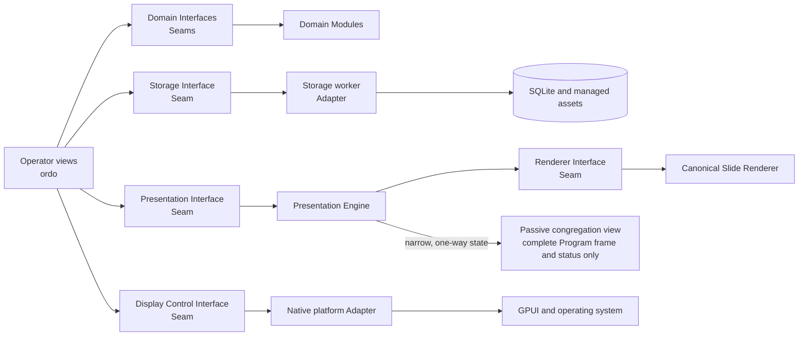
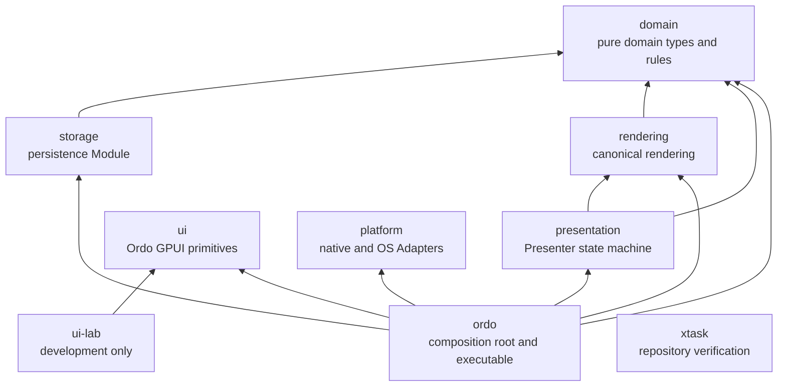

# Ordo MVP Plan

Status: MVP design baseline finalized; clean-slate Rust/GPUI implementation locked
Prepared: 2026-08-22  
Decision source: [`decision.md`](./decision.md)  
Domain language: [`CONTEXT.md`](./CONTEXT.md)  
Execution milestones: [`MILESTONES.md`](./MILESTONES.md)

## 1. Outcome

Build a local-first desktop application that lets one parish prepare and run a regular Sunday or solemnity Mass end-to-end without PowerPoint.

The MVP is successful when an operator can maintain the parish song library, prepare a complete dated Mass plan, transfer it from a connected Windows preparation PC to an air-gapped Windows 10 church PC, and safely present it on a separate congregation display. PowerPoint remains available only as a generated emergency fallback.

The first release is a complete vertical slice:

1. Song and content library.
2. Mass planner.
3. Dual-display Presenter Mode.
4. Offline transfer, recovery, backup, and emergency export.

## 2. Product principles

- **Congregation safety first.** Uncertainty, crashes, missing displays, and failed renders must result in black or no external output—not stale, partial, operator-only, or diagnostic content.
- **One canonical composition.** Timeline thumbnails, Preview, Program, the congregation display, Celebration Packages, and emergency PowerPoint slides all derive from the same canonical rendered frame.
- **Operator context stays private.** Priest or minister triggers, rubrics, warnings, and controls remain on the operator screen.
- **Local-first and offline.** Internet access, login, cloud services, and a source provider are never required to prepare or present captured parish content.
- **Snapshot before presentation.** Live presentation and portable artifacts use immutable Presentation snapshots; editing never mutates a snapshot already in use.
- **Automatic first, reviewed where consequential.** Autosave, pagination proposals, readiness checks, duplicate suggestions, and Presenter preflight reduce manual steps without silently overwriting parish content.
- **Fail operationally.** An incomplete Mass plan may still present its valid Cues. An unavailable Cue can never replace a valid Program frame with an error.

## 3. MVP scope

### Included

- Parish-scoped Songs, aliases, choir repertoire membership, Arrangements, reusable sections, performance sequences, pagination, languages, applicability tags, provenance, and rights notes.
- Structured `song-import` `.ordo` batch import with readable versioned JSON payloads, staged validation, duplicate suggestions, and atomic commit; `.md`/`.txt` provides a separate one-Song human-authoring path into the editor.
- Search across titles, aliases, lyrics, Arrangement titles, attribution, and choirs, with language, choir, numbered-Mass, and occasion filters.
- Archive, restore, reference-safe deletion, and edit revisions for Song works and Arrangements; Song merge and UUID redirects are deferred.
- Parish Mass templates with ordered and conditional Mass items.
- A top-level Library with local Songs, Responses & Prayers, and General Presentations views; reusable non-Song entries remain specialized rather than sharing one generic schema.
- Dated Mass plans for Sundays and solemnities, including linked reusable content, responses, readings, songs, announcements, holds, Blackouts, Wait Cues, operator-only triggers, and projectable Cues.
- Source-neutral Liturgy Import Document review and manual liturgical-content entry.
- Computed Mass-plan readiness: `Incomplete`, `Ready with warnings`, and `Ready`.
- Mass-plan Upcoming, History, Archive, restoration, and **Reuse for another Celebration**.
- Fixed `1920x1080` canonical composition, renderer-owned semantic templates, a minimum `120x80` safe area, automatic pagination proposals, and reviewed slide boundaries.
- Three-column Presenter Mode with responsive visual-grid and compact-list timeline modes.
- Program, Preview, Freeze, Blackout, keyboard navigation, prepared jumps, emergency insert, emergency edit, and crash recovery.
- Explicit congregation-output enablement, display selection, identification, calibration pattern, Output Fit, disconnect recovery, and cursor-location assistance.
- Immutable Presentation snapshots and sessions.
- Self-contained Celebration Packages and complete Parish Backups.
- Validated static-image `.pptx` emergency decks with PowerPoint sections, notes, and black safety slides.
- Windows x64 installer, native Windows CI builds, checksums, and packaged smoke tests. Linux packaging (Flatpak, diagnostic ZIP) is deferred post-MVP (Decision 268).

### Explicitly excluded

- Cloud or LAN synchronization, public sharing, marketplace behavior, and multi-parish tenancy.
- In-application login, staff accounts, granular roles, or approvals.
- Public Sulugoon integration or a runtime third-party extension marketplace.
- Arbitrary PowerPoint import or interpretation.
- Funerals, weddings, baptisms, novenas, and other special rites as qualified workflows.
- First-class Mass-setting families grouping numbered Ordinary movements.
- Choir rehearsal scheduling, attendance, proficiency, or analytics.
- Usage analytics, recommendation engines, remote phone control, audio playback, configurable or content-to-content transitions, and timed Song playback.
- General per-slide styling, advanced revision branches/diffs, shortcut customization, background updates, portable Windows packaging, or public-release code signing.
- Decisions about open-source licensing, commercial licensing, or anti-tamper measures.

## 4. Primary operator journeys

### 4.1 Build the parish song library

1. Create a Song work manually or stage one or more `song-import` `.ordo` artifacts produced against the readable JSON contract.
2. Review automatic import classifications and their evidence; add a Song, attach an Arrangement to an existing Song, skip an unchanged item, or resolve an ambiguous identity before committing the approved batch atomically.
3. Record the primary title, aliases, attribution, source, rights notes, numbered-Mass identity, languages, occasion tags, and choir repertoire membership.
4. Encode each Arrangement's reusable sections once and build its performance sequence, such as `V1 -> C -> V2 -> C`.
5. Generate pagination proposals, review canonical slide previews, and adjust slide boundaries where required.
6. Search, revise, archive, restore, or safely delete eligible Song works and Arrangements without breaking historical references.

### 4.2 Prepare a Mass

1. Create a dated Sunday or solemnity Mass plan from a parish template, or use **Reuse for another Celebration** and assign the new Celebration/date.
2. Import a reviewed Liturgy Import Document or enter responses/readings manually.
3. Select Songs and choir-specific Arrangements; occasion tags rank likely choices but never prohibit another choice.
4. Add, omit, substitute, insert, and reorder Mass items and Cues as needed.
5. Choose the Mass Theme, review identification slides and any item-level Theme override, and inspect rendered slides.
6. Resolve incomplete dependencies and review warnings. There is no Mass approval button.
7. Export the complete Celebration as a Celebration Package for the church PC and optionally generate an emergency `.pptx` for an individual Mass plan.

### 4.3 Transfer and present offline

1. Copy the Celebration Package and qualified installer/update to removable media from the connected Windows preparation machine.
2. Copy and fully verify the Celebration Package in temporary local staging on the air-gapped Windows church PC. Through one staged review, atomically retain its immutable per-plan Presentation snapshots and reconcile its source content into ordinary editable local records.
   On succeeding imports, automatically reconcile non-overlapping local changes through a three-way base/local/incoming comparison and require decisions only for overlapping or unmappable changes.
3. Open Presenter Mode. Automatic preflight checks snapshot integrity, assets/fonts, Cue availability, displays, calibration, rendering, and interrupted-session state.
4. Navigate or rehearse with congregation output disabled.
5. Select/identify the congregation display and explicitly enable output. Program opens black.
6. Use Space to take Preview live; operate the Mass using the fixed keyboard map, Freeze, Blackout, and prepared jumps.
7. Use Insert or `Ctrl+E` for an emergency change; both automatically Freeze Program and create Mass-local content.
8. After the included Masses, export the same self-contained Celebration Package type from the church installation when local changes should return to the preparation computer. Keep the Celebration UUID, create a new Package version, and use ordinary import verification and ancestry-based reconciliation at home.

## 5. Domain model

All durable identities use canonical lowercase UUIDv4 strings generated in Rust with `Uuid::new_v4()`. Creation time is stored explicitly; titles are never identifiers.

| Aggregate or record | Purpose and key relationships |
|---|---|
| Parish scope | Owns the local library, templates, plans, Themes, settings, packages, and backups for one parish. |
| Choir | Lightweight parish singing group with Song repertoire membership; multiple Choirs may share one exact Arrangement. |
| Song work | Canonical song identity with primary title, aliases, attribution, provenance, rights notes, applicability, and archival state. Numbered settings such as Kyrie 8th and Kyrie 13th are separate Song works. |
| Arrangement | Independent choir-, season-, or language-specific rendition belonging to one Song work. Owns reusable sections, sequence, languages, pagination, applicability metadata, and an independent archival state. |
| Arrangement section | Reusable musical/lyrical unit such as a verse, chorus, refrain, bridge, or coda. Stores intentional lyric structure and may generate one or several slides without becoming several sequence entries. |
| Sequence entry | References one Arrangement section and expands repeated sections into the final Cue sequence. |
| Pagination review | Stores proposed/reviewed slide boundaries and whether changes have returned the Arrangement to `Needs Review`. |
| Theme | Reusable congregation-output identity with typography, colors, backgrounds, layout rules, and a safe area. |
| Celebration | Language-neutral dated liturgical occasion and calendar metadata; may own several scheduled Mass plans. |
| Mass template | Named language-specific reusable structure containing concrete content and typed, optionally conditional slots; several templates may exist for one language. |
| Mass plan | Independent editable preparation for one scheduled Mass under a Celebration, with time, primary language, choir and other local context, Theme, ordered Mass items, readiness results, and Mass-local overrides. |
| Mass item | Top-level titled unit such as a song, reading, response sequence, rite, announcement, hold, or Blackout. |
| Cue | Ordered operator event within a Mass item, carrying role, visibility, behavior, private context, and optional projectable output. |
| Wait Cue | Operator-relevant Cue that deliberately leaves Program unchanged, such as an unprojected cantor verse. |
| Mass-local override | Emergency insert or correction owned only by one Mass plan until reviewed promotion. |
| Reusable-source binding | One Mass-plan association that keeps all still-linked occurrences of a reusable source on the same Edit revision. |
| Presentation snapshot | Immutable content and rendering dependency capture for one Mass plan, used by Presenter Mode, as one member of a Celebration Package, or by PowerPoint export. |
| Installed Celebration Package | Verified managed local lineage for one Celebration Package, owning immutable Package versions and one Current version independently of removable media. |
| Package version | One immutable exported state under an Installed Celebration Package, with its own UUID, fingerprint, exact plan set, and per-plan Presentation snapshots. |
| Presentation session | One operator run of a snapshot, with journaled Preview, Program, live state, output availability, and recovery data. |
| Edit revision | Restorable historical state of a Mass plan or library entry, identified by UUID and linked to its parent with canonical content hash, creation time, and origin installation. Restoring creates a later revision. |
| Sync anchor | Latest Edit revision proven common to one mapped source/local entity pair, used to distinguish safe package updates from independently changed content. |
| Library reconciliation | Staged mapping and update review that turns Celebration Package source records into ordinary local records; its decisions never alter the package's immutable Presentation snapshots. |
| Source reference | Informational origin, attribution, retrieval date, license, or permission metadata. |
| Managed asset | Immutable-by-checksum image, background, or other binary referenced by stable ID. |
| Installation display setting | Local display recognition evidence, selected congregation display, calibration status, and Output Fit; never part of a Mass snapshot. |

### Core invariants

- A Song work can own many Arrangements; each Arrangement owns its own sections, sequence, and pagination.
- The underlying musical composition or setting defines Song-work identity. Distinct composers' settings remain separate works even when they share liturgical text; choir variants and translations retaining the same composition are independent Arrangements beneath that work.
- Composer and original authorship belong to the Song work, while translator, adapter, and rendition-specific attribution belong to the Arrangement. One exact Arrangement may be associated with multiple Choirs.
- A Mass plan belongs to one language-neutral Celebration, which may own several plans for different schedules, languages, or choirs. **Duplicate for another Mass** creates an independent plan under the same Celebration; **Reuse for another Celebration** creates one under a different Celebration. Neither workflow keeps the new plan synchronized with its source.
- Conditional template items are evaluated automatically from Celebration metadata but remain visible and overridable in preparation. Missing or conflicting applicability information produces a readiness warning rather than a silent guess; per-plan overrides never silently rewrite the template.
- Templates may contain typed Song and Reading slots. Required unresolved slots contribute to incomplete readiness; additional slots can be added per plan, and multiple independently named templates may exist for the same language and different Celebration shapes.
- Responses and readings are independently authored for each language. Entries may share a neutral liturgical role, but Ordo neither assumes textual equivalence nor translates wording across languages; Reading slots require content matching the plan language. Reusable Responses/Prayers retain explicit language metadata and plan bindings rather than implicit translation.
- One Mass plan resolves one Edit revision per reusable source. All still-linked occurrences use that binding; a reviewed update advances them together, while Mass-local overrides remain independent and immutable Presentation snapshots never change.
- Every Cue belongs to exactly one ordered Mass item.
- Operator-only triggers and Hold Cues have black projectable output while retaining private context. Wait Cues leave Program unchanged.
- A Presentation snapshot is immutable and self-contained with respect to its rendering dependencies.
- A Presentation session references exactly one snapshot.
- Archive is reversible visibility. Permanent deletion never cascades through retained history.
- Database and managed-asset mutations commit consistently; a committed record cannot reference a missing asset.

### Role and projection defaults

- `P` means `Pari` (Priest); `T` means `Tanan` (the entire congregation).
- The role model remains explicit and extensible to deacon, lector, cantor, choir, commentator, and operator.
- Spoken dialogues project the congregation response by default; priest or minister text remains operator-only context.
- Scripture readings project responses, Psalm refrains, and acclamations by default. A planner may enable full-reading projection for an individual reading.
- Ordinary Gospel content is an ordered language-template sequence: optional opening P/T exchange, identification, congregation acclamation, optional Scripture Slides, and closing P/T exchange. Presets may omit blocks where the rite requires it, including the reviewed Good Friday form, rather than hard-coding Sunday wording.
- A Responsorial Psalm projects its linked refrain before the first cantor verse and after every cantor verse. Cantor verses are Wait Cues by default, leaving the refrain visible, and may be enabled as projected Scripture-style Slides.
- Every Cue records its speaker/actor role, congregation visibility, parent Mass item, order, and operational behavior such as project, wait/trigger, hold, or Blackout.
- The normal live timeline favors operator-relevant Cues; full missal context may be expandable without cluttering the primary sequence.

## 6. Architecture

The architecture favors deep Modules: each exposes a small domain-shaped Interface while concentrating complex Implementation behind a deliberate Seam. GPUI is the native view/window framework and must not own domain rules.

### 6.1 Core Modules and Seams

| Module | Interface responsibility | Complexity hidden by the Implementation |
|---|---|---|
| Song Library Module | Search, create/revise/archive/restore/delete eligible Song works; create/revise/archive/restore/delete eligible Arrangements, manage repertoire, and stage/commit imports. | Duplicate evidence, full-text indexing, revision capture, reference-safe lifecycle rules, and atomic import decisions. |
| Mass Planning Module | Create/reuse/revise/archive plans; manipulate ordered Mass items and Cues; compute readiness. | Template expansion, conditional items, referential validation, warning policy, history organization, and Mass-local override promotion. |
| Pagination Module | Propose and review slide divisions for Arrangement content under a Theme. | Phrase-aware splitting, line budgets, minimum sizes, safe-area geometry, overflow detection, and invalidation after edits. |
| Canonical Slide Renderer | Produce a canonical rendered frame or a structured render failure from content, Theme, and target density. | Font loading/fallback, deterministic wrapping, 1920×1080 geometry, safe area, contrast/overflow checks, image composition, caching, and density scaling. |
| Presentation Engine | Accept navigation/output commands and expose complete deterministic Presenter state. | Cue traversal, linked/frozen/blackout semantics, unavailable-Cue protection, Program/Preview state, output-disabled/disconnected states, journaling intent, and recovery transitions. |
| Snapshot and Portability Module | Capture/reuse snapshots; export/import/verify Celebration Packages and Parish Backups through the shared Artifact Container Module. | Dependency closure, hashing, manifest/version validation, atomic file operations, conflict reporting, rollback, and snapshot reuse. |
| Artifact Container Module | Inspect, create, safely extract, validate, and route universal `.ordo` ZIP-plus-JSON exchange containers. | One typed interface hiding path safety, extraction limits, artifact-kind manifests, schema versions, integrity checks, payloads, and optional assets. |
| Emergency PowerPoint Export Module | Export and validate a `.pptx` from a Presentation snapshot. | Full-frame images, section metadata, speaker notes, safety slides, temporary generation, reopen validation, and atomic publication. |
| Storage Module | Execute domain-shaped asynchronous persistence operations. | SQLite schema, SQL, transactions, migrations, indexes, integrity checks, journaling, asset coordination, and backup mechanics. |
| Display Control Module | Discover/identify/select displays and control the passive congregation window. | Operating-system display events, topology, focus, cursor location, aspect fitting, Output Fit, disconnect handling, and display recognition evidence. |
| Presenter Preflight Module | Return actionable pass/warn/fail results for a snapshot and local presentation environment. | Snapshot checks, asset/font validation, readiness carryover, renderer probe, display checks, and recovery discovery. |

The deletion test should hold for each Module: removing it would force its rules into several callers. If a proposed Module only forwards data, fold it into the deeper owner instead.

The principal runtime Seams are:



### 6.2 Dependency strategy

The initial crate contract permits the following internal dependency
directions. An arrow means the crate at its tail may depend on the crate at its
head; it does not require every permitted dependency to be present.



- Domain computation and the Presentation Engine are in-process dependencies and are tested directly through their Interfaces.
- SQLite and filesystem behavior are local-substitutable dependencies. Test the Storage Module through its Interface using temporary databases and asset directories rather than exposing repository ports to callers.
- GPUI plus `gpui_platform` is the permanent native shell selection. This is not a provisional Adapter awaiting another shell bake-off, and no Electron fallback application is maintained.
- Operating-system display/window behavior is isolated at the Display Control Seam. Production uses a GPUI/native-platform Adapter; state-machine tests use an in-memory Adapter.
- Pin the Rust toolchain, Cargo lockfile, GPUI/gpui-platform revision, and any optional GPUI behavior dependency used by a release. Upgrade pre-1.0 framework revisions only through an explicit compatibility and qualification task.
- The production application starts from a clean repository and source tree;
  this plan and the committed production repository are authoritative.
- PowerPoint generation is isolated at the export Seam because file-format tooling may change. Validation operates on the produced artifact, not the generator's internal representation.
- Content-source helpers remain outside Ordo. Their only core-facing Seam is a versioned Song import document or Liturgy Import Document.

### 6.3 Native runtime ownership

- **GPUI application/UI thread:** owns application lifecycle, GPUI entities, window composition, focus, input dispatch, operator views, and the passive congregation view. It performs no blocking database, filesystem, pagination, image-encoding, or PowerPoint work.
- **Presentation Engine:** in-memory Rust Module receiving commands and returning complete deterministic Presenter state. Both operator and congregation views subscribe narrowly to its state; the congregation view exposes no operator commands, diagnostics, planning, clipboard, or file operations.
- **Storage worker:** one dedicated Rust worker thread owns the SQLite connection and managed-asset transactions behind typed asynchronous requests. The planned baseline is `rusqlite`; Phase 0 qualifies the pinned driver and may revise only the internal Adapter without changing the Storage Interface.
- **Background executor/workers:** pagination, thumbnail preparation, image decoding/encoding, hashing, import/export, and other measured CPU or I/O work run away from the UI and Presenter hot path. Results return as typed values and may never mutate Program partially.
- **Native platform Adapter:** owns display discovery, window placement/fullscreen, topology changes, cursor behavior, and packaged file dialogs without leaking GPUI/platform types through domain Interfaces.
- **Window decoration:** Preparation uses native/server operating-system decorations for MVP. Presenter is borderless full-screen. A custom client-side titlebar is deferred unless qualification demonstrates an operational requirement.

### 6.4 Suggested source layout

```text
Cargo.toml
Cargo.lock
rust-toolchain.toml
crates/
  domain/                 # pure Song/Mass/Pagination domain Modules
  storage/                # Storage Interface, rusqlite worker, migrations/assets
  rendering/              # Canonical Slide Renderer, shaping, fonts, frames
  presentation/           # Presentation Engine, session journal, preflight
  platform/               # GPUI/native display, window, filesystem Adapters
  ui/                     # internal Ordo GPUI primitives, tokens, accessibility
  ordo/                   # feature views, composition root, `ordo` executable
tools/
  ui-lab/                 # development-only interactive primitive scenarios
contracts/                # versioned readable JSON schemas and examples
packaging/                # Windows installer, release metadata
tests/
  fixtures/
  golden-frames/
  packaged-smoke/
xtask/                    # verification, packaging, fixture, and release commands
```

This is the initial locality map, not permission to create pass-through crates.
Phase 0 Artifact Container and PowerPoint feasibility work remains in
development-only `tools/*-spike` packages rather than entering an unrelated
production crate. Portability and PowerPoint export begin at their owning
milestone and receive dedicated `portability` or `powerpoint` crates only when
their Interfaces hide enough complexity to earn that extraction. A crate
remains only when its Interface preserves meaningful dependency direction.
Otherwise the Module stays in the closest existing production crate that
preserves dependency direction, and the affected milestone Changes paths are
updated before implementation begins.

### 6.5 Operator UI foundation

- Build the internal `ui` Module on GPUI, using a pinned and qualified
  `gpui-base` for useful unstyled behavior. It supplies buttons, fields, menus,
  tooltips, popovers, selects, comboboxes, disclosures, tabs, dialogs,
  nested slideovers, focus treatment, virtualized collections, and semantic
  state without becoming Ordo's visible product vocabulary.
- Translate approved HTML references and `DESIGN.md` tokens conceptually into GPUI layout/style code. HTML, CSS, Tailwind classes, React components, shadcn, and Base UI are reference material only and are not production dependencies.
- Qualify `gpui-base` in Phase 0, pin its exact compatible revision with GPUI,
  review its license and dependency tree, and contain it inside `ui`. Do not
  adopt the styled `gpui-component` layer wholesale or leak either library's
  properties into workflow Interfaces. Direct GPUI remains available for
  custom Ordo surfaces and as the internal fallback if a base behavior fails
  qualification.
- Maintain `tools/ui-lab` as a development-only native executable depending on
  `ui`, not the complete `ordo` application. Give each primitive curated,
  reusable scenarios for its meaningful states, Preparation and Presenter
  appearances, supported Interface scales and viewport presets, keyboard and
  focus behavior, constrained overlays, accessibility semantics, and long or
  multilingual content. The same scenarios feed manual exploration and the
  automated GPUI UI harness; the lab is never included in parish packages.
- Render every dialog and slideover through one application-owned overlay layer bounded to the current native window viewport rather than pane height. Dialogs, ordinary slideovers, and unpinned Presenter Ordo share one visible dim scrim that captures and dismisses on outside click without activating content beneath it; pinning Ordo removes the scrim. Preserve exterior gutters; when content is taller than available space, keep header and actions reachable while its body scrolls internally. Apply the same boundary to nested slideovers and verify it in resized windows and at increased Interface scale.
- The visible product vocabulary remains in deep Ordo Modules such as Presenter Workspace, Cue Timeline, Output Dock, Arrangement Editor, and Theme Editor. Their Interfaces consume Ordo state and commands and do not expose primitive-library properties to callers.
- The canonical frame viewport, thumbnail virtualization, pagination surface, arrangement sequence surface, Theme canvas, display-topology view, and calibration pattern remain custom Implementations at their established Seams.
- Bundle every font, icon, and UI asset into or beside the native application with verified manifests. No installed runtime path requires a CDN, registry, web font, or network resource.
- Avoid generic dashboard styling: nested cards, large radii, decorative gradients/glows, ubiquitous pills, arbitrary accents, and low-density whitespace are not Ordo's visual language.
- Maintain root `DESIGN.md` in the Google Labs `design.md` format as the normative visual-system source: machine-readable YAML tokens plus human-readable rationale. Keep workflow behavior in this plan and approved examples in `design-references/` rather than making either a competing token source.
- Because the external format is alpha, pin an exact `@google/design.md` version when the implementation workspace is initialized. Lint and contrast-check through the cross-platform `designmd` command, and review specification upgrades deliberately.
- Distinguish four interaction meanings across all Ordo Modules: Disabled is a temporarily inapplicable control; Unavailable is content or capability that cannot currently fulfill its purpose; Read-only is intentionally inspectable non-editing content; and Not assigned is a valid empty configuration. Primitive-library properties must not collapse these meanings.
- Use native disabling only when the reason is locally obvious. Keep consequentially blocked actions keyboard-focusable with a persistent associated reason. Keep Unavailable content legible, inspectable, and linked to correction while preventing invalid live or commit actions; omit editing controls in Read-only contexts instead of fading whole forms.
- Centralize a two-layer keyboard-focus treatment in `ui`: a `2px` immediate-surface separation ring plus a `2px` blue outer ring, using the adopted Preparation and Presenter focus tokens. Pointer activation alone does not retain this custom ring.
- Keep keyboard focus independent from selection and semantic or operational state. Selection remains a forest-green tinted fill while focus remains an outer blue outline; both may coexist. Apply focus outside canonical `16:9` frame wrappers, never inside their rendered composition, and preserve system highlight behavior in Windows High Contrast mode.
- Keep `Tab`/`Shift+Tab` in visible reading order through explicit GPUI focus handles, without trapping ordinary panes. Provide `F6`/`Shift+F6` to jump among visible major regions: Global navigation, Workspace header/actions, primary list or Mass outline, main editor, and Inspector. Hidden regions are skipped; selection updates contextual content without stealing focus; component-level arrow keys retain their expected list, tree, grid, tab, menu, and Cue-navigation behavior.
- In Presenter Mode, cycle visible regions as Ordo rail, Cue timeline, then Output Dock and controls, skipping a closed unpinned rail. Region navigation must never alter Preview, Program, Freeze, Blackout, or output state. Focused modal dialogs and slide-overs contain focus and return it to their invoking control or nearest surviving relevant entity on close.
- Expose AccessKit semantics using visible domain vocabulary: Global navigation, Workspace actions, the applicable primary list or Mass outline, main editor, Inspector, Cue timeline, Program, Preview, and Output controls. Give each interactive Cue a concise label containing position, title or first line, type, and project/wait/hold/Blackout behavior; expose complete slide text or private context as its description rather than an oversized label.
- Let focused Cue navigation provide its own spoken feedback instead of duplicating every arrow press through a live region. Use one deduplicated polite status channel for expected operational transitions, and urgent announcements only for unexpected safety events such as display disconnection, Cue unavailability, automatic Freeze, or loss of usable Program output. Urgent wording states both the failure and Ordo's protective result.
- Keep operator-only prompts and diagnostics in the operator accessibility tree only. The passive congregation window contains solely congregation-facing canonical output and no focusable operator surface.
- Use `1px` neutral separators and shared pane edges for ordinary structure. Prefer row dividers and restrained surface changes over individually boxed content, prevent doubled borders between adjacent surfaces, and keep fixed panes free of card shadows.
- Reserve the strong neutral border tokens for controls or boundaries whose edge must itself remain perceptible, canonical frames, active drop targets, and temporary overlays. Do not turn strong borders into decoration or selection treatment; selection remains a tint and keyboard focus remains its independent two-layer outline.
- Use only the adopted ordinary radii: `4px` for controls, interactive-row treatments, compact elements, and operator slide viewports; `8px` for menus, dialogs, slide-overs, and other temporary elevated surfaces. Keep fixed panes, tables, dividers, and ordinary open lists square, and reserve fully rounded geometry for genuine circles, status dots, or compact status labels.
- Render every operator-facing slide frame through identical `4px` clipped viewport chrome without changing its internal canonical composition. Keep the underlying `1920x1080` render and congregation output square and edge-to-edge; the radius never enters Slide Themes, saved content, or exports. Apply keyboard focus outside the rounded wrapper.
- Use only two appearance-specific elevation levels: Floating for menus, popovers, dropdowns, and tooltips; Overlay for dialogs, slide-overs, and the focused child in a nested slide-over sequence. Every elevated surface retains a neutral border, while fixed panes, rows, buttons, selections, and slide frames remain flat.
- Combine nested-child Overlay elevation with parent recession without stacking progressively stronger shadows. Keep shadows neutral and prohibit colored glows or shadows from communicating operational, interaction, or liturgical state.
- Bundle Lucide as Ordo's only general operator-interface icon family, import only used SVG modules, and retain the applicable license notices. Use `16px`/`20px` icons with a consistent `2px` stroke; pair high-stakes or unfamiliar actions with visible labels and restrict icon-only controls to familiar compact actions with accessible names and matching tooltips.
- Keep ordinary icons outlined and use filled shapes only for meaningful status markers. Route any necessary Ordo-specific SVG through the same icon Module and visual rules rather than introducing another general icon family or emoji.
- Build layouts from the adopted `4px` spacing scale, using `8px` for related elements, `16px` for groups, and `24px` for major sections. Use `36px` default controls/rows, permit `32x32px` compact icon controls, and keep high-stakes Presenter controls at least `40px` high.
- Place operator-only toasts at bottom-center. Confirmation and Undo may expire; failures and hazards remain attached to a clear owner until resolved or deliberately dismissed.
- Use `16px` primary workspace gutters at `1366x768` and `24px` at `1920x1080`. Spend wider-screen space on previews, slide columns, and context rather than proportional application scaling; allow increased interface text to grow rows and reflow secondary content without clipping.
- In constrained Preparation workspaces, preserve the editor as the fixed primary surface, convert Inspector and eventually the primary list/outline into opposing slideovers, and allow only one temporary side pane at a time. Restore fixed panes and their contextual state when space returns; never solve constraint with application-level horizontal scrolling.
- Ship one adaptive MVP density and no Compact/Comfortable preference.
- Provide installation-specific Interface scale steps at `100%`, `125%`, `150%`, `175%`, and `200%`, controlled through Settings and `Ctrl++`/`Ctrl+-`/`Ctrl+0`. Apply scale only through operator-shell typography and layout tokens; never multiply the canonical Slide's logical layout scale.
- Isolate every canonical Slide from Ordo Interface scale, Windows system scaling, GPUI window scale factor, and physical output density. Always compose in explicit `1920x1080` logical coordinates. A target-density rerender may improve sampling sharpness but may not change font metrics, wrapping, pagination, safe area, or element geometry.
- Treat timeline thumbnails, Inspector, Preview, and Program as uniformly scaled viewports onto the completed canonical frame. Operator scaling may alter viewport size, grid columns, and surrounding chrome only. Fit the passive congregation view to physical output through the qualified Output Fit path without recomposition.
- Use `120ms` quick and `160ms` standard motion. Open dialogs/slideovers in `400ms` with fast-start/slow-finish motion and close in `200ms` with smooth acceleration. Keep every transition interruptible and prohibit spring, bounce, overshoot, and decorative looping.
- Keep content-to-content Preview/Program changes as immediate cuts. Fade content to/from Blackout or Hold over `500ms` independently per output surface; contrary commands reverse from current opacity with proportional remaining time and never queue. Under reduced motion, remove spatial transforms and limit clarifying opacity—including blank boundaries—to `100ms` while preserving interaction and focus sequence.

### 6.6 Application appearance polarity

- Preparation offers System (default), Light, and Dark appearance. System follows operating-system changes live; Light uses the warm paper-neutral appearance and Dark uses the graphite family.
- Presenter Mode renders with a graphite-dark appearance appropriate to a dim church and keeps canonical Preview and Program frames visually dominant.
- The two appearances share the same operator typography, geometry, spacing, control hierarchy, icons, focus behavior, and operational state semantics.
- Liturgical colors remain inside congregation Themes and canonical slide previews; they never recolor the ordinary operator shell.
- Presenter always selects graphite dark and restores the saved Preparation preference on exit.
- Operator appearance and congregation Theme are independent inputs. Neither may alter the other's saved or rendered result.
- Share one semantic color language across both appearances: forest green for primary action and selection, clear green for Live, amber for Freeze and warning/incomplete findings, near-black plus a light label and border for Blackout, muted red for error/destructive conditions, and restrained blue for information. Pair every operational state with text and an icon or shape cue.
- Keep liturgical purple, red, green, rose, and white exclusive to actual liturgical metadata and Slide Theme content rather than reusing them as generic interface accents.

### 6.7 Operator typography

- Use locally bundled `Atkinson Hyperlegible Next` throughout the operator interface as well as congregation-facing projection.
- Use Regular, Medium, and SemiBold for operator hierarchy; reserve ExtraBold primarily for projected lyrics and congregation responses.
- Use locally bundled `Noto Sans` as the missing-glyph fallback across both surfaces. Do not depend on fonts installed by the operating system and do not fetch fonts at runtime.
- Design dense metadata, keyboard hints, navigation labels, and table-like content for Atkinson's comparatively wide letterforms. Prefer deliberate truncation, disclosure, or layout adaptation over undersized text.
- Never truncate Live/Freeze/Blackout wording, output health, warnings/errors, readiness counts, scheduled times, or contextual primary actions. Current workspace/entity titles may wrap to two lines; narrow list/outline/Ordo rows use one-line ellipsis; Cue captions may use two lines. Full truncated values appear on pointer hover and keyboard focus and remain complete in accessible text.
- Collapse older breadcrumb ancestors into accessible overflow before shortening the current entity. Move secondary metadata into its owner before compressing primary identity/state/action text. Never ellipsize authored lyrics, readings, responses, announcements, notes, or canonical Slide content; use wrapping or bounded local scrolling and prohibit marquee or below-minimum font shrinking.
- Qualify interface fit, truncation, line wrapping, and numeric alignment at both required operator resolutions: `1366x768` and `1920x1080`.

### 6.8 Preparation-shell navigation

- Use a persistent vertical application rail for preparation workspaces rather than a generic dashboard landing page.
- **Masses** is the default destination and contains **Upcoming**, **History**, **Archive**, and **Templates** views. Templates are parish preparation content rather than application settings.
- Present Upcoming and History as chronological Celebration groups with subordinate scheduled Mass-plan rows, including plan time, language, choir, and readiness. Keep groups expanded in Upcoming and allow older History groups to collapse; retain the same hierarchy even when a Celebration has only one Mass.
- Creation is Celebration-first: create the language-neutral Celebration, then create a new Mass plan beneath it or reuse an earlier plan for that new Celebration. Celebration headers own shared details and group actions; rows open a plan and own plan-specific actions.
- Use **+ New Celebration** as the primary action. After saving it, offer **Create from template**, **Reuse an earlier Mass plan**, or **Do this later**; an empty Celebration remains valid and exposes those actions inline. After one plan exists, **+ Add another Mass** reuses the same two starting methods.
- Keep the Celebration's liturgical date separate from each plan's actual scheduled start. Permit an explicitly confirmed **Anticipated** plan on the preceding civil day, display its real date/time beneath the later Celebration, and order Upcoming groups by their earliest scheduled plan. An empty Celebration uses the local start of its liturgical date as the fallback ordering key.
- Show an Installed Celebration Package's Current version as the same single Celebration group used by its reconciled editable records, with ordinary chronological Mass-plan rows and restrained package provenance. Keep Package history and artifact administration in **Transfer & Backup** rather than duplicating Mass navigation.
- Offer **Export Celebration Package** from the Celebration group's contextual menu and **Export celebration** from Transfer & Backup. Route both into one viewport-spanning floating slide-over that summarizes change/reuse status, every chronologically grouped plan, readiness, blockers, size, destination, and collapsed package contents; plans are informational because partial Celebration Packages do not exist.
- Allow incomplete plans to be exported with visible per-plan readiness warnings so preparation can continue elsewhere. Block only failures that prevent a complete, internally consistent, checksummed, self-contained artifact from being captured and atomically published.
- Do not equate **Anticipated** with a generic Vigil mode; specialized vigils may require distinct Celebration context and templates.
- Require only liturgical date and title for Celebration creation, and scheduled start plus primary language for Mass-plan creation. Keep other metadata optional while surfacing unresolved conditional rules, choir-dependent Song slots, duplicate schedules, and inconsistent timing relationships through validation or readiness as appropriate.
- Use a hybrid navigation hierarchy: the vertical application rail owns global destinations, while horizontal tabs belong only to local views inside the current destination or editor.
- **Library** is the primary destination with local **Songs**, **Responses & Prayers**, and **General Presentations** views. Songs owns Song works, Arrangements, Choir repertoire, and Song-import workflows. **Themes** and **Transfer & Backup** are the other primary destinations; anchor **Settings**, **Help**, and **Diagnostics** at the bottom of the same global rail.
- **Masses** uses **Upcoming**, **History**, **Archive**, and **Templates** as horizontal local tabs. Arrangement and Theme editor tabs likewise change the current entity's task/view rather than navigating to another global destination.
- Launch Presenter Mode from a selected Mass plan so the presentation context is explicit.
- Show icons with persistent labels at comfortable widths. At constrained widths, collapse the rail to accessible labeled icons with tooltips while preserving a non-color-only active-workspace treatment.
- Preparation workspaces retain their full primary-list-or-outline, editor, and Inspector composition at qualified `1366x768`/`100%`. Adapt from effective available dimensions after system scale, Interface scale, window size, and navigation chrome, preserving minimum logical widths of `240px` for the list/outline, `520px` for the editor, and `300px` for Inspector rather than using a monitor-resolution breakpoint.
- Use `design-references/ordo-mass-planning-responsive*` as the paired visual-acceptance baseline: the compact target retains all three panes and the wider target preserves their ownership while exposing more outline rows, metadata, generated Cues, and canonical-preview area. Treat the reference as hierarchy evidence rather than exact production dimensions.
- When constrained, keep the primary list or Mass outline beside the editor while moving Inspector into a labeled right slideover; at narrower effective widths preserve only the editor and expose both side regions as opposing labeled slideovers. Only one temporary side pane opens at a time. Never add whole-workspace horizontal scrolling or squeeze the editor below its useful minimum.
- Preserve selection, scroll position, editor/autosave state, and meaningful focus targets across responsive transitions. Keep the current entity visible in compact chrome, leave the primary workspace action visible, and move only lower-priority actions into a labeled accessible overflow. Returning to sufficient width restores fixed panes without treating layout as persisted Parish content.

### 6.9 Mass Planning workspace

- Opening a Mass plan replaces the list view with a focused planner; a breadcrumb returns to the originating Masses subview.
- Keep a plan header above three permanent structural panes: **Mass outline**, **selected-item editor**, and **Inspector**. The header owns Celebration context, autosave state, readiness, Mass Theme access, and the Presenter entry point.
- Generate one enabled-by-default selectable Celebration-title Cue before the first Mass section. It inherits the Celebration title and Mass Theme, may use a Mass-plan title override, and serves as the idle Cue. Its appearance may inherit the Mass Theme, select another reusable Theme, or replace only the background with one Mass-local image.
- The Mass outline contains ordered Mass-item titles and local ordering controls. Place **+ Add Mass item** in its header at the top-right; compact it to an accessibly named `+` button only when width requires it. Keep the header otherwise clean: the MVP has no outline-wide `...` menu, because plan-wide actions belong to the plan header and item actions belong to each Mass item.
- Group the Mass outline into ordered **Mass sections** copied from the selected template. New templates begin with **Before Mass**, **Introductory Rites**, **Liturgy of the Word**, **Liturgy of the Eucharist**, **Concluding Rites**, and **After Mass**; Communion remains within Liturgy of the Eucharist. Before/After Mass are operational wrappers rather than liturgical rites. Templates and copied plans may independently add, rename, reorder, and remove sections, but removing a non-empty section never cascades to its Mass items. Sections have stable local identity plus editable labels, with no hidden liturgical type or name-derived behavior; cross-language derivation uses the target template's structure. A Mass section owns no Cue or output and must not be confused with an Arrangement section; remaining interaction rules are the next design branch.
- Always show empty sections in template and plan authoring, allow individual and expand/collapse-all disclosure, retain item/readiness counts on collapsed headers, and automatically reveal a section when navigation targets one of its items. Keep collapse state outside content and revision history. Presenter Mode omits empty sections.
- Build each section header from a drag handle, disclosure caret, unique nonblank name, counts, and one consistent right-click/`...` menu for rename, add above/below, move, and eligible removal. Clicking the header body activates it as the insertion target and clears item selection; the editor and Inspector then show **Select an item**. Keep at least one section in every plan/template, require every Mass item to belong to exactly one section, disable removal of non-empty or final sections, and omit section duplication from the MVP.
- Allow exactly one selected Mass item in the MVP, with both the editor and Inspector following it. Defer multi-selection and bulk item actions.
- **+ Add Mass item** opens an anchored type dropdown that identifies the complete section-aware insertion destination. Insert immediately after the selected Mass item in its section, or append within an actively targeted section. If neither an item nor section is active, including an item-empty plan that still owns at least one section, require a destination section rather than silently appending to the Ordo; per-item **Insert before** and **Insert after** commands reuse the same chooser. The created item becomes selected and its section expands.
- Selecting a type immediately creates, selects, and autosaves the item, with Undo as the recovery path. Provide editor presets for Song, Reading, linked Response/Prayer, General Presentation, Hold, Blackout, and **Custom sequence**; the latter is the flexible escape hatch formerly described as a blank item.
- Treat Hold as an ordinary operator-only black Cue, not a persistent state. Treat Blackout as an explicit state-changing Cue that remains active while Preview navigation continues until Space takes Preview live.
- The selected-item editor owns type-specific content and sequence work. The Inspector owns canonical slide inspection, warnings/dependencies for the selected scope, and item-level Theme override.
- Song/Arrangement picking opens a floating right slide-over instead of adding a fourth permanent pane. Selection is staged until a sticky top-right action such as **Use Choir A arrangement** commits it.
- Attach an accessibly named **Close Song picker** `›` control to the slide-over's left boundary; `Esc` provides equivalent dismissal. Closing without committing leaves the Mass item unchanged.
- Keep the commit action continuously reachable in the sticky header; do not duplicate it at the bottom of the desktop slide-over. A constrained layout may shorten its visible wording while preserving the full accessible meaning and selected-Arrangement context.
- Open a floating **Mass details** slide-over from the plan header without losing the selected Mass item. Separate shared Celebration fields (date, title, season, color, applicability tags) from plan-specific fields (time, language, choir, Presider, location, private notes). Deliberately omit liturgical grade/rank from the MVP. Presider and Location use editable suggestions rather than dedicated directory screens; Parish Settings may supply lightweight Regular Presiders, an optional Default Presider, and a Default Location copied only into newly created plans, while private notes remain unrestricted multiline text. Prioritize Regular Presiders, separate recent guest suggestions, and accept immediate custom names. Confirm shared Celebration edits, recompute readiness and review findings without silently changing existing plan items or schedules, preserve reused plans under other Celebrations, and leave existing Presentation snapshots immutable.
- Allow unrestricted hierarchical reordering in the Mass Outline through dedicated handles or focus-scoped `Alt+Up` and `Alt+Down`. Moving a section carries all its items; moving an item across a boundary changes its section membership, with a bottom item moving to the next section's beginning and a top item moving to the previous section's end. Accept empty and temporarily expanded collapsed sections as pointer destinations. Keep the moved entity focused and visible, autosave the operation, and support Undo without introducing global reorder shortcuts or multi-item movement.
- Give every Mass-item row one identical menu through right-click and its hover-or-focus `...` affordance: add above/below, duplicate, move up/down, and **Remove from this Mass**. Removal affects only the plan placement, applies immediately with Undo, and never deletes referenced reusable library content or mutates an existing Presentation snapshot.
- Keep the Inspector free of a generic `...` menu. Expose previous/next canonical-slide navigation and position, inspected-slide warnings, item-level Theme override, and contextual **Fix pagination** explicitly; keep Mass-item actions in the outline and editing actions in the selected-item editor.
- Navigate the Inspector through the selected Mass item's flattened Cue order and label it **Cue n of total**. Projectable Cues show their authoritative canonical frame; operator-only triggers show a black congregation frame with private timing context outside it. Synchronize editor/Inspector selection and stop at item boundaries rather than silently selecting another Mass item.
- Open a floating **Readiness** slide-over from explicit header counts such as **1 incomplete · 2 warnings**. Group computed findings as **Incomplete presentation** and **Review recommended**, identify their plan or item scope, provide a jump that preserves the panel and a corrective action that closes it and focuses the owning editor control, and remove findings automatically when corrected. Keep **Present** available for incomplete plans behind acknowledgment while disabling unavailable Cues; reserve a true Presenter-entry block for failure to capture or open a coherent snapshot.
- Introduce a compact semantic `StatusLabel` with this readiness UI, its first production caller. Do not add a generic Badge to the foundational T0.3 primitive set or turn ordinary labels and containers into pills.
- On **Present**, finish pending autosave and validate a presentation candidate for the exact current Mass revision. Enter directly when clean or carrying review-only warnings. For incomplete content, use the approved centered, viewport-bounded `ordo-incomplete-preflight*` modal: compactly list unavailable Cues by section/item, initially focus **Review and fix**, and offer warning-toned **Present available content** as the acknowledgment without a checkbox. Cancelling or reviewing creates no snapshot; after proceeding, reuse an unchanged snapshot or persist a new one automatically. Snapshot capture/open failure remains a fatal in-planner blocker. Presenter opens with congregation output disabled and no output window.
- Keep **Exit Presenter** visible without a single-key shortcut. Exit directly when congregation output is disabled; otherwise require a centered **End presentation?** confirmation that initially focuses staying. Confirming forces Program black before closing output, marks the session complete, clears interrupted recovery, leaves native full-screen, and restores the operator window and exact pre-Presenter planner context while preserving saved emergency changes. Unexpected termination continues through fail-closed interrupted-session recovery.
- Open a viewport-height floating **Mass Theme** slide-over—with the standard exterior gutter—from the plan header. Preview staged parish Themes on the selected canonical `16:9` slide, identify the applied Theme, and keep the Mass plan unchanged until the sticky commit action is used; close or `Esc` discards the staged selection.
- Disclose item-level Theme overrides without silently replacing them. **Review** opens a nested child slide-over while the parent recedes; Back preserves the draft. Show every override in Mass-outline order as `current override → inherited result`, stage per-item or all-item inheritance changes, and commit them together with the staged Mass Theme as one Undoable change set. Existing Presentation snapshots remain immutable.
- Route **Edit selected theme** to the dedicated Theme Editor for the highlighted reusable Theme without applying it to the Mass plan; returning restores the Mass Theme chooser and its staged Theme and override decisions.
- Autosave both groups with Undo. Identify when Celebration details are shared with sibling Mass plans and require confirmation before applying a shared change; ordinary plan-specific edits apply immediately.

### 6.10 Mass Template workspace

- Manage reusable templates under **Masses → Templates**. Allow several independently named templates per language and filter the library by language and advisory applicability metadata.
- Opening a template reuses the planner's three-pane structure for its ordered outline, selected concrete item or typed slot editor, and Inspector.
- Let templates own ordered Mass sections and copy their section/item structure into each new Mass plan. Concrete reusable Songs, Responses/Prayers, and General Presentations retain Library links through instantiation; template structure itself remains independent, later template edits do not synchronize, and each plan may customize its section structure.
- Let each language-specific template own optional default projected headers for
  Responses and the Responsorial Psalm. Copy those authored strings into the
  Mass plan; items may inherit, hide, or override them, while the renderer and
  Celebration perform no language lookup or translation.
- Applicability ranks likely choices but never prohibits deliberate template selection. Flexible representation of a specialized rite does not imply qualified MVP support for that rite.
- Creating a Mass plan materializes an independent copy of the selected template revision. Later template edits affect future plans only; provenance does not imply synchronization, and reapplying template changes to an edited plan is deferred.
- When creating a plan, rank templates using language and Celebration applicability. Visibly preselect the best match while allowing the operator to change it; a specific match outranks the parish's optional general fallback for that language.
- If no applicable or fallback template exists, create an empty plan with a readiness warning. Choir assignment does not influence template selection; it resolves the resulting Song slots through choir Arrangements.
- **Duplicate for another Mass** makes a complete independent copy when the language is unchanged. If the target language changes, derive the new plan from its recommended target-language template, retain only language-compatible Arrangements matched by liturgical role, and leave readings or other language-bound custom content unresolved. Preview retained and unresolved content before creation.
- **Reuse for another Celebration** marks every copied Reading **Needs Review**, even when language is unchanged. Editing or explicitly reviewing one Reading clears its flag; **Mark all readings reviewed** clears the remainder after confirmation.

### 6.11 Theme Editor workspace

- Use a dedicated preparation workspace with one dominant canonical `16:9` preview. Entry from a Mass plan retains contextual **Back to Mass Theme** navigation and the chooser's staged state; entry from top-level **Themes** has no Mass context.
- Provide stable **Celebration title**, **Song identification**, **Lyrics**, **Response**, **Reading identification**, **Reading passage**, **Responsorial Psalm**, **General text**, and **General image** preview specimens. Add **Current Mass slide** only for Mass-plan entry. Changing specimens tests the Theme against different content without editing Mass content or changing which reusable Theme rule is being edited.
- Render every specimen through the canonical `1920x1080` pipeline so wrapping, density, placement, overflow, and contrast feedback match downstream slides.
- Separate controls into **Typography**, **Appearance**, and **Layout**. Typography covers text role, bundled typeface, preferred/minimum size, weight, and line spacing. Appearance covers the text/background pair, picker plus hexadecimal input, parish colors, immediate preview, computed contrast, and background assets. Layout covers horizontal/vertical placement, safe area, and maximum text width.
- Keep specimen selection distinct from text-role selection. Lyrics and responses use the projection body role; identification titles, credits, and labels may use the established secondary role.
- Edit a reusable Theme through a staged session: the canonical preview updates immediately, but the saved Theme and inheriting Mass plans remain unchanged until explicit **Save**.
- Permit in-place editing of a shared Theme. Before Save, prominently disclose **Used by N Mass plans** and warn that saving will update every editable inheriting plan; immutable Presentation snapshots remain unchanged.
- Provide **Duplicate Theme** as the safe branch from the same staged result. Duplication creates an independent Theme without altering the source Theme or any plan inheriting it.
- Every successful Theme **Save** creates an Edit revision. Confirm the Theme name and affected editable-plan count, then offer **Undo**; Undo restores the preceding Theme state as a later revision and rerenders currently inheriting editable plans without altering immutable Presentation snapshots.
- Automatically rerender every inheriting editable plan after Save or Undo. Require no approval for clean results; offer **Review affected plans** only for new overflow/contrast warnings, changed pagination or slide count, or newly incomplete projectable items. Route each finding directly to the exact affected content in its owning editor.
- Mark staged edits visibly as **Unsaved changes**. Back, close, or navigation away from a dirty session offers **Save changes**, **Discard changes**, and **Keep editing**; a clean session exits directly. `Ctrl+S` invokes the ordinary guarded Save flow rather than bypassing shared-impact warnings.
- Treat successful **Duplicate Theme** as resolution of the staged session: publish the staged result as a new independent Theme and do not ask the operator to discard those same changes from the source.
- Prefill a compact duplicate-name dialog from the source Theme, then switch the editor to the new independent Theme. Library entry remains in library context; Mass-plan entry returns to the preserved chooser with the duplicate staged as the candidate, never implicitly applied before the chooser commit.
- Manage reusable Themes through **Edit**, **Rename**, **Duplicate**, **Set as parish default**, and recoverable **Archive**. Archived Themes leave existing inheriting plans intact and can be restored; require a replacement before archiving the parish default. Defer permanent deletion.
- Protect a bundled dependency-free black/white safety Theme from in-place editing, renaming, or archival while allowing it to be selected or duplicated.
- Expose labeled **History** in the Theme Editor header. Its right slide-over lists revision time, generated change summary, and affected-plan count; allow canonical preview and guarded restoration. Restoring creates a new latest revision, rerenders current inheritors, and uses the ordinary exception-based review without changing immutable snapshots.
- Support either a solid background color or one image background in the MVP. Images use Cover fitting, focal-position control, one adjustable color overlay, and a required fallback color; include referenced images in portable packages and backups. Defer gradients, textures, multiple layers, and per-specimen backgrounds.

### 6.12 Selected Song-item editor

- Keep the selected Song-item editor focused on the current Mass plan. Show liturgical role/title, selected Song and Arrangement, language, Choir availability, Arrangement section sequence, and generated Cue/slide counts, but keep reusable lyrics and sequence read-only by default.
- Route **Change song or arrangement** through the staged picker and **Open in Song Library** to the reusable library editing context.
- Require the explicit **Customize for this Mass** action before editing Arrangement-derived content in the plan. Mark the result visibly as a **Mass-local override** in both the editor and Inspector; never mutate the reusable Song or Arrangement implicitly.
- Preserve the authoritative canonical Inspector frame and its source, section/occurrence, warning, Theme inheritance, and owner-directed pagination route in both Arrangement-backed and Mass-local states.
- On customization, copy the Arrangement's current sections, performance sequence, and approved pagination into an independent Mass-local override. Later library Arrangement edits do not change that local copy.
- Preserve reusable-section behavior inside the local copy: editing a local section updates all of its repeated occurrences by default; **Edit this occurrence only** forks one occurrence, while reorder/removal changes only the sequence.
- Apply ordinary Mass-plan autosave, revisions, Undo, and readiness/pagination recomputation to copy creation and local edits.
- When **Change song or arrangement** replaces a customized item, preserve the staged picker and use a nested comparison/review before commit. Clearly disclose that Ordo will detach—not merge—the Mass-local lyrics, sequence, and pagination; recompute the replacement from its reusable Arrangement after confirmation.
- Treat **Return to library arrangement** as a direct guarded action rather than a nested picker transition: open one focused confirmation slideover comparing the Mass-local override with its original reusable source.
- Keep the previous customized state recoverable through Undo and Edit revision history. Preserve focus, staged selection, directional layering, cancellation behavior, and reduced-motion equivalence across all picker/review transitions.
- Present the performance sequence as primary section-occurrence rows. Expanding one reveals its generated congregation-facing slide Cues in exact order; repeated occurrences remain separate Cue positions while visibly sharing their linked section source.
- Reorder generated content only by moving whole section occurrences. Keep individual slide splitting and composition in the applicable reusable or Mass-local Lyrics editor, and never permit a generated slide to be dragged across section boundaries.
- Selecting a generated Cue drives the authoritative Inspector frame. Inspector previous/next traverses the flattened Cue order and opens the containing occurrence as needed; one compact context-sensitive **Expand all / Collapse all** control changes disclosure only.
- Show an enabled-by-default identification slide as a distinct Song-level Cue above the section-occurrence sequence. It remains the first Cue in the flattened Song order, uses the Theme's Identification specimen, and is selectable in the authoritative Inspector.
- Source identification title and credits from reusable Song/Arrangement metadata, while allowing per-Mass-item visibility and Mass-local presentation changes without mutating the library source.
- Keep identification outside reusable Song sections and fixed before the first section occurrence. Hold and Blackout remain separate Mass items rather than hidden Song Cues.

### 6.13 Response-sequence item editor

- Author a Response-sequence item as ordered exchange blocks. Each block contains an optional operator-only trigger followed by one required congregation response.
- Default the roles to Priest (`P`) and congregation (`T`) while allowing explicit substitution of deacon, lector, cantor, commentator, and other supported roles.
- Flatten each block into Presenter order as its private trigger followed by the generated response slide Cue or Cues; omit the trigger position cleanly when no trigger is authored.
- Selecting a private trigger shows the established black Preview plus operator-only text. Selecting a response Cue drives the authoritative canonical Inspector frame.
- Display generated response Cues beneath their exchange block and route any splitting or overflow work into the owning Response-sequence editor.
- Direct arbitrary cue mixtures and control behavior to Custom sequence rather than broadening the focused exchange model.
- Select a reusable Response/Prayer entry by default. Keep it read-only while linked and require **Customize for this Mass** before changing its blocks locally.
- Resolve one Library-source Edit revision per Mass plan. Repeated linked occurrences use that same binding; an upstream change produces **Update available** until reviewed, then advances every still-linked occurrence together. A local override retains its source/base revision and remains independent.
- Allow reviewed **Update reusable source** from a local override. If upstream moved since its base, compare the editable latest source beside the Mass-local text and require an explicit new revision rather than automatic merge or overwrite.
- Keep reusable wording language-specific and available through both templates and direct Library insertion; never infer translation from the Celebration or another language entry.

### 6.14 Mass-editor persistence and Undo

- Autosave ordinary Mass-plan edits locally and show quiet **Saving…** / **Saved** status in the plan header; selected-item editors have no routine Save button.
- Coalesce a continuous text-field editing session into one undoable revision after one second of inactivity or focus departure rather than recording every keystroke.
- Create separate undo points for structural and semantic commits, including add/remove/reorder, Song/Arrangement replacement, customization boundaries, and pagination approval.
- After structural changes, provide temporary **Undo** feedback while retaining `Ctrl+Z` as the persistent latest-edit path.
- Keep guarded confirmation flows for destructive-boundary operations, and flush pending edits durably on editor/application close without requiring a network connection.

### 6.15 Song-work creation and duplicate preview

- Use a persistent desktop master-detail Song Library: sticky search/filter/results and **New song** controls on the left, selected Song identity and Arrangement list on the right. Selection updates detail in place, and returning from an Arrangement restores the query, filters, selection, and result scroll position; progressively stack only below ordinary desktop width.
- Preserve that permanent master-detail shell before the first Song exists. Show **No songs yet** with **Create song** primary and **Import `.ordo`** secondary in the results pane, while the detail pane concisely explains Song creation/import, Arrangement lyrics and Sequence, and optional Choir/usage metadata. Do not use a transient welcome dashboard or oversized onboarding artwork.
- When a populated library's query has no results, show **No songs match** with **Clear search and filters** instead of first-use copy. When only archived Songs exist, show **No active songs** with **Show archived**. Keep the workspace chrome and pane geometry stable across these states.
- Apply Choir, language, and occasion filters to Arrangements and retain a Song-work result only when one Arrangement satisfies all active filters. Show matching-versus-total counts, order and emphasize matches in Song detail, keep nonmatches visible but subdued, and treat absent Choir or occasion metadata as **Unspecified** rather than universal.
- Search normalized, case-insensitive Song titles, aliases, attribution and source metadata together with Arrangement titles, translator/adapter attribution, Choirs, languages, and full lyrics. Require an Arrangement-owned query match and every active filter to be satisfied by the same Arrangement; explain non-obvious alias and lyric matches compactly without altering authored display text.
- Create a Song work independently of any Arrangement. Require only its primary title; keep composer/original author, aliases, liturgical moments, occasion tags, provenance, and rights notes optional.
- Exclude lyrics, language, Choirs, sections, sequence, and slide boundaries because those belong to an Arrangement.
- Commit with an explicit **Create song** action, then select a valid **No Arrangements yet** overview with an optional **Add first Arrangement** next action. Subsequent Song-detail edits autosave normally.
- Collapse duplicate evidence into a compact possible-match count. Expanding it reveals concise candidates; selecting one opens a nested viewport-bounded identity preview rather than navigating away or rendering the full Song page.
- Preserve the staged New Song form on Back. **Use this existing Song** deliberately abandons creation and selects the existing library entry; preview alone changes nothing.
- Limit the nested preview to identity evidence: title/aliases, composer/source, liturgical moments, and compact Arrangement, Choir, and language summaries, with lyric excerpts only when needed to distinguish a match.

### 6.15a Reusable Library views and source lifecycle

- Keep one Library destination with local **Songs**, **Responses & Prayers**,
  and **General Presentations** views. Share search, archive visibility, History,
  and source-impact vocabulary, but retain type-specific editors and models.
- General Presentation Text mode owns optional header/body/footer. Image mode
  owns one foreground image plus optional header/caption. Its reusable entry
  owns an eight-second auto-play default with optional per-Slide overrides.
- A Mass item may pair either mode with Mass-local private delivery context.
  Keep that operator-only context outside the reusable source and every
  canonical frame.
- Exclude archived entries by default and expose **Include archived**. Existing
  bound Mass items remain renderable with an **Archived source** notice; restore
  the source before ordinary editing. Permit permanent deletion only before any
  retained plan/template/history reference exists.
- A source edit creates a new revision and marks bound plans **Update available**
  rather than silently mutating prepared content. Reviewing one plan advances
  all of its still-linked occurrences atomically; Presenter sessions and
  Presentation snapshots stay pinned.
- A Mass-local override remembers its source and base revision. Promotion opens
  latest-source-versus-local comparison when upstream moved, never auto-merges,
  and saves only through an explicit new source revision.

### 6.16 Song import review

- Validate imported documents before mutation and stage automatic **Add new Song**, **Attach Arrangement**, **Skip unchanged**, and **Needs decision** classifications with concrete identity and content evidence.
- Keep invalid documents inspectable but excluded with precise contract failures. Require every ambiguous candidate to be resolved before commit, and let the operator change any suggested action.
- Commit all approved library mutations in one transaction; a failure leaves the entire approved batch unchanged.
- Open imported content and selectable nearest library candidates in one read-only, viewport-bounded full-app comparison slideover with **Overview**, **Lyrics**, **Sequence**, and **Slides** views. Comparison never edits content or mutates the staged action.
- Route a meaningfully changed near-duplicate Arrangement to **Needs decision** with **Add as new Arrangement**, **Update existing Arrangement**, and **Skip document** outcomes. Updating replaces the whole reusable Arrangement as a restorable revision after disclosing affected Choirs and unsnapshotted Mass plans; it never merges internal lyrics, sections, Sequence, or pagination automatically, and it never changes Mass-local overrides or immutable snapshots.
- Resolve Song-work identity once per import document, then classify every contained Arrangement independently. Never distribute one document's Arrangements across several Song works; reject the entire document if any contained Arrangement or internal reference is invalid, and block batch commit while any contained Arrangement decision remains unresolved.

### 6.17 Arrangement Editor workspace

- Use two primary task tabs: **Lyrics** and **Sequence**. Keep Arrangement metadata in the dedicated header details surface rather than adding another task tab.
- Open Arrangement metadata in a viewport-bounded floating **Arrangement details** surface. Use the same staged surface for creation and editing, with explicit **Create Arrangement** and **Save details** commits and Cancel discarding staged changes.
- Require at least one language. Keep the display title optional and derive its visible label from language and Choir context when blank; allow optional multi-Choir association, translator/adapter attribution, advisory occasion applicability, and source/rendition/rights notes.
- Keep composer and original-author attribution on the Song work. Keep lyrics, reusable sections, sequence occurrences, and slide boundaries in their owning Lyrics and Sequence tasks.
- Warn before saving details for an Arrangement shared by several Choirs. Saving updates the reusable record and library discovery metadata without breaking Mass references or mutating immutable Presentation snapshots; **Duplicate Arrangement** provides the deliberate branch path.
- Adapt that same surface for **New Arrangement**: omit existing-record actions, validate at least one language, and persist only after **Create Arrangement**. Then select the new Arrangement and land in Lyrics.
- Allow a deliberately created Arrangement to contain no sections. Show **No sections yet** with **Add first section** focused, retain that empty Arrangement if the operator leaves, and do not create a speculative **Verse 1** automatically.
- Give a section one required free-form name without a separate MVP Section Type. Create it from a compact anchored popover with editable suggestions such as Verse, Chorus, Refrain, Bridge, and Ending; custom labels remain unrestricted.
- Propose the next sensible numbered name, commit with **Add section**, then select the new section and focus its lyric editor. Rename from the selected section's compact action surface and preserve all lyrics, slide boundaries, approvals, and linked Sequence occurrences.
- Let operators reorder the Lyrics section list through drag handles or `Alt+Up` / `Alt+Down`. This changes only reusable-section authoring/navigation order, autosaves with Undo, and never changes Sequence performance order or occurrence references.
- Keep section creation in Lyrics independent from occurrence placement in Sequence. Never append to the performance order implicitly; offer an explicit contextual **Add to Sequence** shortcut after creation.
- Mark a non-empty Arrangement with no Sequence occurrences as incomplete, but allow unused authored sections without warnings. Each explicit repeated placement remains a distinct occurrence linked to the same reusable section.
- Remove an unused section as an ordinary structural edit with **Undo**. If occurrences reference it, confirm the named section and occurrence count, then remove the section and all linked occurrences atomically.
- Make Undo restore the complete section content, pagination/approval state, and occurrences at their original positions. Never rewrite immutable Presentation snapshots through a later library removal.
- Omit a dedicated **Duplicate section** action in the MVP. For the uncommon slight-variation case, let the operator create an independently named section and copy-paste the source lyrics; creating that section still does not place it in Sequence automatically.
- Insert an explicitly added Sequence occurrence immediately after the currently selected occurrence. If none is selected, append it; in an empty Sequence it becomes first. Use the same rule from Sequence and the Lyrics-side **Add to Sequence** shortcut, then select the inserted occurrence.
- Let **Repeat occurrence** insert another occurrence referencing the selected occurrence's reusable section immediately afterward. It copies no lyrics or generated slides; adding the same section again remains an equivalent, slower path.
- Reorder complete Sequence occurrences through drag handles or `Alt+Up` / `Alt+Down`, autosaved with Undo. Every generated slide moves with its occurrence; individual slide order stays Lyrics-owned, and multi-selection remains deferred.
- Remove a selected occurrence immediately with Undo and without deleting its section. Support `Delete` only while the occurrence row/list owns focus, choose the next then previous occurrence afterward, and show an explicit incomplete empty state if the last occurrence is removed.
- Keep an empty Sequence as a saved but **Incomplete** draft. Its empty state explains sung-order placement and focuses **Add first occurrence**; a referencing Mass exposes a readiness finding and a new snapshot receives no Song slides from that Arrangement until it has an occurrence.
- Compute Arrangement readiness only from Sequence-referenced sections: blank or unrenderable referenced content is **Incomplete**, unapproved referenced pagination is a warning, and unused sections are ignored. Deduplicate repeated-section findings while stating the affected occurrence count.
- Identify Sequence occurrences by current one-based position plus their unchanged section name. Collapsed rows show generated-slide counts; expanded rows reveal fixed-order child slides that drive the Inspector, while positional labels recompute after structural edits.
- Reuse the three-pane Arrangement shell in Sequence: Available sections with explicit Add actions on the left, ordered expandable occurrences in the center, and the authoritative canonical Inspector on the right. Merely selecting an available section never mutates Sequence.
- In Lyrics, select a reusable section and edit its exact text, intentional line breaks, section language, automatic slide proposal, manual slide boundaries, generated canonical frames, fit warnings, and approval state together.
- Make lyric entry keyboard-first: a normal newline continues the current slide, while one blank source line starts the next slide. Removing that blank line joins the neighboring slide groups through ordinary text editing rather than a special Backspace command.
- Place the two mouse equivalents together and label them with their current exact targets, such as **Split after line 2** and **Join slide 2 with slide 1**. Disable joining on the first slide and show the quiet rule **A blank line starts a new slide.** instead of persistent shortcut badges.
- Allow one section to generate several slides. A slide boundary changes only presentation subdivision inside that section; it does not create another section or sequence entry.
- Do not force artificial Verse 1A/Verse 1B sections for projection splitting. Permit such names only when the underlying musical or lyrical structure genuinely warrants distinct sections.
- In Sequence, order and repeat section occurrences without duplicating their lyric text. Each occurrence expands to every generated slide owned by its referenced section.
- Preserve the authoritative canonical Inspector across both tabs. Route imported `Needs Review` pagination and later overflow findings directly to the affected section in Lyrics. Do not create a dedicated Pagination Review workspace at Arrangement or Mass-plan level.
- Show generated frames as a compact wrapping navigator of fixed-size `16:9` thumbnails that never stretch when a row is sparse. Selecting one focuses its source range and drives the single authoritative large Inspector preview.

### 6.18 Song and Arrangement persistence

- Autosave ordinary Song-detail fields and Arrangement lyric text after one second of inactivity or focus departure, coalescing each continuous typing session into one undoable edit.
- Persist section, Sequence, and slide-boundary structural changes immediately as discrete undo points. Keep **Create song**, **Create Arrangement**, and staged **Save details** as explicit transactional boundaries rather than treating their surfaces as ordinary autosave forms.
- Show quiet **Saving…**, **Saved**, and **Couldn’t save** status in the editor header without a routine global Save button.
- Flush pending local edits before navigation or application close. On failure, retain the recoverable edit and warn before leaving instead of silently discarding it.
- Keep immediate Undo/Redo local to the currently open Song or Arrangement editor session. Let a focused text field consume native text Undo first, then expose committed text sessions and structural operations through the editor-local stack and temporary **Undo** feedback.
- Clear immediate Undo/Redo when leaving that entity or restarting Ordo; never let `Ctrl+Z` alter another unseen library entry. Recover older or cross-session states through durable Edit revisions and explicit History, with restoration recorded as a new latest revision.
- Capture every committed Undo point as a durable Edit revision. Group consecutive revisions into readable, expandable editing-session entries in History while keeping creation, import, whole-Arrangement replacement, and restoration as standalone events.
- Retain all Song and Arrangement revisions in the MVP; omit automatic pruning and retention settings until measured parish usage justifies them.
- Start a History session on the first committed edit after opening an entity and end it on navigation to another entity, application close, or 30 minutes without a committed change. Keep Lyrics/Sequence work together for one Arrangement, but never group Song-work edits with Arrangement edits.
- Expose labeled **History** actions in the Song-detail and Arrangement-editor headers. Open an entity-owned, full-app floating right slideover that preserves the underlying editor, flushes pending autosave, summarizes grouped sessions and provenance, and expands them to individual revisions.
- Open a selected revision in a nested read-only comparison slideover. Compare Song identity/metadata directly; compare Arrangements through **Overview**, **Lyrics**, **Sequence**, and authoritative **Slides** views, emphasizing differences while retaining unchanged-content access.
- Restore only whole Song or Arrangement revisions in the MVP. Use an in-place two-stage footer: **Restore this revision** changes the footer to a warning-tinted, uncarded confirmation with a full-width impact message and a separate **Keep current** / **Restore entire…** action row.
- Disclose Arrangement Choir and editable-plan impact, preserve Mass-local overrides and immutable snapshots, create restoration as a new latest revision, and offer immediate **Undo** as another later revision.
- Archive and restore an Arrangement independently from its Song work. Hide archived Arrangements from ordinary pickers, retain explicit archive discovery and every historical reference, and allow permanent deletion only when no durable record refers to the Arrangement.
- Keep **New arrangement**, **Arrangement details**, and entity-owned **History** visible in their owning headers. Place Song archive and Arrangement archive in the corresponding header overflow; expose Restore and reference-aware permanent deletion there for archived entities, while keeping **Duplicate arrangement** inside Arrangement Details.
- Treat Song archival as a non-cascading availability boundary: it suppresses all child Arrangements from ordinary planning but does not rewrite their individual archival states. Restoring the Song exposes only child Arrangements that were independently active.
- Confirm recoverable archive operations in a compact dialog with entity-specific impact and unchanged-reference disclosure. Return to the next Song or parent Song as appropriate, offer immediate Undo, and expose archived content through a dedicated library status filter.
- Keep archived Songs and Arrangements inspect-only until restored. Preserve full content and History visibility, show a prominent Archived/Restore state, and distinguish independently archived children from active children that are merely suppressed by an archived parent.
- Permit permanent Song deletion only for an archived, childless, otherwise unreferenced Song. Never cascade deletion through Arrangements; require each Arrangement to pass its own explicit reference-safety review first.
- Preserve an archived Arrangement in every Mass plan that already references it and classify the condition as an **Archived library source** warning, not missing content. Carry that reference with explicit review when duplicating/reusing a plan, exclude it from unrelated new selection, and block permanent deletion while any retained plan or snapshot still refers to it.
- Route permanent deletion through one reference-safety dialog. Block the commit and identify/link durable references when unsafe; when safe, disclose deletion of the entity and its owned revisions and require one explicit, non-undoable **Delete permanently** confirmation without title re-entry.
- Defer Song merging, retiring-Song redirects, merge History and reversal, and their specialized conflict/dependency handling until after the MVP. Do not ship a partial or irreversible merge action in the initial deployment.

### 6.19 Settings diagnostics

- Provide **Settings → Diagnostics** as a completely offline, operator-only health page with one clear **Healthy** or **Needs attention** summary.
- Inspect application/build identity, operating system and hardware, renderer/GPU details, database/schema integrity, managed assets, bundled fonts, storage/free space, display assignment and calibration, recent verified transfer/Backup activity, and crash or interrupted-session evidence.
- Keep **Run diagnostics** non-mutating. Findings link to the workflow that owns the corrective action rather than placing unrelated repair controls on the page.
- Hide collection complexity behind a deep Diagnostics Module that returns one normalized result to the UI and can later supply an export surface. Diagnostics never reaches Program or congregation output.
- Offer **Copy summary** and **Export diagnostic report** without any automatic upload or Send action. Export produces a `diagnostic-report` Ordo file through the Artifact Container Module using only the Diagnostics Module's sanitized result.
- Include check results, environment facts, error codes, timestamps, anonymous correlation IDs, and sanitized recent logs. Exclude parish name, titles, lyrics, readings, notes, media, usernames, hardware serials, complete paths, and file bodies; replace necessary path roots with generic labels.
- Show the latest completed full result and its completion time immediately. Refresh only inexpensive live facts on page entry; run database integrity, full asset hashing, font validation, and renderer qualification only through an explicit **Run full diagnostics** action.
- Run the full scan asynchronously with visible progress and cancellation. Preserve the prior completed result when a run is cancelled, interrupted, or fails, and never publish a partial attempt as the current overall health assessment. Do not start a full scan automatically during Presenter Mode.
- Use one full-page, single-column Settings hierarchy: compact header and scan action; overall health strip; action-required findings; then collapsible bordered rows for Data & assets, Fonts & rendering, Displays, Transfer & backups, Application & system, and Recent problems. Collapsed rows retain status and finding counts.
- Keep Copy summary and Export diagnostic report together after the detail as secondary actions. At wider sizes, increase row detail rather than turning Diagnostics into a generic card dashboard.

### 6.20 First-run Parish setup

- When no Parish scope exists, show one focused **Set up Ordo** page with **Start a new parish** and **Restore a parish backup**. Do not show a tutorial carousel, account prompt, or internet-dependent onboarding.
- New-Parish setup requires only a Parish name. It also offers optional Default Mass location and Regular Presiders; one entered Regular Presider becomes the Default automatically, while several permit an explicit default or no default.
- Store Regular Presiders as a lightweight ordered suggestion list in **Parish Settings → Defaults**, not as clergy directory records. New plans copy the optional Default Presider; their editable Presider combobox prioritizes Regular Presiders, separates previously used guests, and accepts a custom name immediately.
- Generate the Parish UUID only when new-Parish setup commits, then open the empty Masses workspace with **Create first Celebration**, **Import `.ordo`**, and **Create or manage templates**. Do not require content language, Choir, Theme, display, telemetry, or other optional setup, and do not permit skipping Parish identity.
- Initial Backup restore reuses the full-page verification/review flow and adopts the Backup's Parish identity. Since no current Parish scope exists, omit a pre-restore safety Backup; enforce the ordinary recoverability prerequisite on every subsequent replace-only restore.

### 6.21 Empty Mass Templates workspace

- Preserve the permanent Mass Templates list-editor workspace before any template exists. Show **No templates yet**, explain that templates provide reusable Mass sections, recurring responses, and typed Song/Reading slots for one language, and make **Create template** the primary action.
- Ask only for template name and language, then create through the same Template Module interface used by later creation actions and open the existing editor with the six-section scaffold. Insert no speculative responses, readings, rubrics, Songs, or other language-specific liturgical content.
- Do not force template setup before Mass planning. Where neither an applicable template nor a language fallback exists, preserve the adopted empty-plan creation path and visible readiness warning.

### 6.22 Empty Choir workspace and quick creation

- Preserve a compact permanent list-detail workspace under **Songs → Choirs**. Before any Choir exists, show **No choirs yet**, explain its role in Arrangement discovery and Mass planning, and make **Add choir** primary.
- Require only the name at creation; keep short label, preferred languages, private notes, and Active or Archived state optional. Songs and Arrangements remain valid without Choir association, and **Not assigned** remains an explicit selector value where applicable.
- Let editable Choir selectors quick-create an unmatched typed name after normalized, case-insensitive duplicate checking, then select it without leaving the current task. Route this and full management through one Choir Module interface. Keep Archived Choirs out of ordinary suggestions unless deliberately revealed in management.

### 6.23 Fallback-only Theme Library state

- Always show protected **Ordo Black** under **System Theme**, with its canonical specimen and **Built in** status. When it is the current Parish default, show that status separately. Never label a library containing this safety Theme as empty.
- When no parish-owned Theme exists, show **No parish themes yet** under **Parish Themes** with **Create parish theme** primary. Create an independent renderable copy of Ordo Black through the Theme Module and open it in the staged Theme Editor.
- Keep Ordo Black as default until explicitly replaced. Permit selection and duplication, but prohibit in-place editing, renaming, archival, and deletion.

### 6.24 Invalid and unresolved import review

- Distinguish **Invalid** contract/integrity/dependency/version failures from structurally valid **Needs decision** identity or reconciliation ambiguity. Invalid content can never be force-imported; Needs-decision content blocks commit only until its operator choice is resolved.
- Keep invalid inputs inspectable in review with an exact reason and **Choose another file**, **View technical details**, and **Remove from review**. Identify an unsupported newer schema as requiring a compatible Ordo version rather than calling it corrupt.
- In multi-document Song/Liturgy intake, exclude invalid documents while allowing independently valid documents to proceed. Reject a whole Song import document when any contained Arrangement or internal reference is invalid. Treat Celebration Packages and Parish Backups as indivisible and block the entire artifact on any required-part failure.
- Make no Parish, database, managed-asset, or Package-history mutation until the accepted valid set commits atomically.

### 6.25 Missing Theme-background recovery

- Render a missing or corrupt saved Theme image through its required fallback color, mark the Theme **Degraded**, and expose one deduplicated advisory Mass Readiness warning. Never show a broken or partial image on congregation output.
- Preserve the missing reference in the Theme Editor with **Replace image** and **Remove image**. Allow acknowledged Presenter entry and a new local snapshot of the complete fallback-color result; leave prior validated immutable snapshots unchanged.
- Block Celebration Package export until the referenced image is replaced or deliberately removed because portable editable dependency closure remains incomplete even though local fallback presentation is coherent.

### 6.26 Theme-background image qualification

- Recommend `16:9` source images at `1920x1080` or higher without enforcing either property. A non-`16:9` selection shows **Not 16:9 · Parts of this image will be cropped** beside its Cover preview and focal-position control; a smaller selection shows **May appear soft on higher-resolution displays**.
- Treat a saved visible crop as intentional Theme output and do not convert its source aspect ratio into an ongoing Mass Readiness warning. Keep both qualifications advisory and reuse them across image selection, replacement, and import.

### 6.27 Self-healing bundled-font integrity

- Verify a versioned runtime font cache against a pinned manifest and retain a verified read-only factory font pack. Reconstruct and atomically replace a damaged cache from that pack automatically, then require a renderer probe; successful repair creates only a quiet Diagnostics record.
- If the factory pack alone is damaged while the runtime cache remains verified, continue all rendering and export normally but report non-blocking **Font recovery copy missing**. Direct the operator to run a trusted same-version installer and keep packaged-resource replacement owned by the installer.
- If neither local copy verifies, never substitute system fonts for projectable output. Keep management authoring available, block exact new previews, snapshot capture, and Celebration Package export, and permit Presenter Mode only from a previously validated snapshot with intact pre-rendered canonical frames.
- Use full reinstall with Parish-data preservation only after ordinary same-version installer repair fails. Centralize cache verification, reconstruction, and renderer qualification behind the Font Integrity Module while the installer owns application-resource replacement.

### 6.28 Unavailable future Cue during Presenter Mode

- If a selected Cue unexpectedly lacks a complete canonical frame, never alter congregation output. Preserve the previous valid Program and automatically enter **Frozen · Cue unavailable** when output had been Live; preserve Blackout if it was already active.
- Show one operator-only **Output unavailable** placeholder with the specific reason identically in its Cue card and Preview. Keep the Cue in navigation, permit navigation to later Cues, and require Space on a valid Preview to resume live output. Space on an unavailable Preview leaves Freeze or Blackout intact and explains the refusal.
- Reuse the Presenter Preflight and Cue-availability result at runtime so corrupted, undecodable, or newly failed frames cannot bypass the complete-frame-or-structured-failure contract.

### 6.29 Interrupted-session Presenter recovery

- Reopen an unexpectedly terminated Presentation directly in Presenter Mode without a blocking recovery dialog. Keep external output black and show **Presentation recovered · Congregation output is black** persistently in operator chrome.
- Restore Preview, journaled navigation/state intent, and emergency changes; show the prior Program frame only as private context. Recreate a confidently recognized previously enabled output window black, otherwise enter Disconnected without reassignment.
- Space takes a valid recovered Preview live and dismisses the recovery strip. Preserve the ordinary safe **Exit Presenter** path for an obsolete recovered session.

### 6.30 Installer repair and version relationships

- Running the same-version Windows installer repairs packaged application resources while leaving Parish data outside the installation directory untouched. Rebuild the runtime font cache and run integrity/renderer checks after relaunch; no data Backup is required when no stored data changes.
- A newer installer performs the adopted offline application upgrade and creates a verified local safety Backup before any first-launch schema migration. It is never used merely as a font source for an older running build.
- Refuse in-place downgrade and cross-version font extraction from an older installer. If an older app is launched despite that protection, refuse a newer Parish schema without mutation.

### 6.31 Uninstall and retained Parish data

- Default uninstall to **Keep Parish data — Recommended**: remove application binaries and disposable caches while preserving the complete app-managed Parish scope and local Backups outside the install directory for a compatible reinstall.
- Offer explicit **Remove all local Ordo data** with an exact category summary, latest portable-Backup evidence, an unprotected-change warning when applicable, and one danger confirmation without typed-name ceremony. This deletes only app-managed local data and never exported `.ordo` files elsewhere or on removable media.
- Keep application removal and Parish-data deletion as separate installer operations so repair/reinstall cannot accidentally widen into data loss.

### 6.32 Retained Package and Backup damage

- Distinguish inaccessible **Unavailable** artifacts from accessible but verification-failed **Damaged** artifacts. Keep both visible with precise evidence; neither counts as current protection, and Damaged artifacts cannot be imported, restored, or presented from.
- Never salvage or rewrite a Damaged archive. **Locate another copy** may atomically replace it only when exact artifact identity and full fingerprint verify; otherwise use ordinary import/version handling. A healthy current Parish may create a new Backup instead.
- Verify retained artifacts, extracted dependencies, imported local records, and independent Presentation snapshots separately so one damaged managed copy does not invalidate sound siblings. Route current Parish-store corruption through Diagnostics and Parish recovery.

### 6.33 Keyboard-shortcut reference

- Provide labeled **Keyboard shortcuts** entry points under Help and in the Presenter Ordo-rail footer, with `Ctrl+/` toggling the same viewport-bounded floating right panel. Avoid a bare `?` binding.
- Group exact keycaps and concise commands by Global, current workspace, Editing, and Presenter, with current context first. Omit search and customization from the MVP and centralize visible bindings with registered commands behind one Shortcut Reference Module.
- Keep the panel passive in Presenter so it never changes Program and `F`, `B`, and `Space` remain active. Preserve the adopted suspension of all single-key Presenter commands in text editors, emergency editing, and true modals. `Esc` closes and restores prior focus.

## 7. Canonical rendering contract

- Compose every slide in a fixed `1920x1080` logical canvas.
- Preserve text wrapping, line breaks, positions, and pagination across physical resolutions.
- Use renderer-owned semantic header, body, and footer zones; absent edge content collapses its zone. Do not support freely draggable elements.
- Use Atkinson Hyperlegible Next ExtraBold for emphasized lyrics/responses and titles, Regular for Scripture, and Medium/SemiBold for references/credits/labels; use bundled Noto Sans for missing glyphs. Exact numeric levels remain provisional until the Canonical Slide Layout Gallery is visually qualified.
- Retain a guaranteed black/white fallback Theme with no decorative dependency.
- Default important-content safe area is 120 horizontal and 80 vertical canvas units. Themes may increase but not reduce it.
- Default lyric body size is 72 canvas units; automatic reduction stops at 64.
- Pagination targets two logical lyric phrases and no more than four rendered lyric lines per slide.
- Split at intentional line or phrase boundaries before reducing size; never silently clip or shrink below the minimum.
- Lyrics preserve authored casing and optionally repeat their section label at top-left. Response text stores authored casing but renders uppercase beneath an optional repeated authored header resolved before rendering at the pending Response-only candidate 113px/400 (90 * 1.25 = 112.5, rounded; 130px advance), centered horizontally and centered vertically in the available body zone; `TUBAG:` is the Cebuano template default, not a renderer literal.
- Reading identification uses the normalized mixed-case authored proclamation title at candidate 135px/800, left-aligned to safe-area left and vertically centered above its bottom-left reference; do not add First/Second/Gospel labels. Reading passages use the pending ReadingPassage-only candidate 88px/400 (70 * 1.25 = 87.5, rounded; 102px advance), left-aligned and top-anchored above the unchanged 50px bottom-left reference; GeneralText stays at 70px with no operator/UI change. Passages retain their existing authored case, per-slide reference, and blank-line boundary behavior.
- Responsorial Psalm emits one linked refrain before the first cantor verse and after every verse. Its optional authored small header is copied from or overridden against the plan/template wording; `SALMO RESPONSORYO` is the Cebuano template default, not a renderer literal. An unprojected cantor verse is a Wait Cue that leaves Program unchanged; an enabled cantor projection uses Reading-passage treatment.
- Song identification uses a bottom-left uppercase title/credit block. Celebration title preserves authored mixed case at 135px/800, left-aligned; optional Normal-Case subtitle is 68px/300 below it; title/subtitle group centers above the unchanged bottom-left localized date. No operator/UI change. Both permit at most three title lines before readiness warning.
- General Presentation Text mode supports optional header, center-left body, and optional footer. Image mode contains one foreground image in the safe area with optional header/caption; Theme images remain backgrounds.
- Higher-density output may rerender the same geometry for sharpness but cannot recompute layout.
- Ratios within 0.1% of 16:9 fill the display. Other ratios preserve the complete frame with black bars and a warning.
- Output Fit uniformly scales the completed frame inward by 0–10%; it never alters composition.
- Projectable consumers receive either a complete frame or a structured failure. Partial frames are never valid Program output.

## 8. Presenter state and controls

### 8.1 State model

| State | Program behavior | Navigation behavior | Space |
|---|---|---|---|
| Congregation output disabled | No external window exists. | Preview changes normally. | Cannot expose output until it is explicitly enabled. |
| Enabled, black | External Program exists and is black. | Preview changes independently. | Takes current Preview live. |
| Live / unfrozen | Program and Preview are linked; selecting a projectable Cue cuts immediately to it. Operator-only triggers/Hold produce black; Wait leaves Program unchanged. | Changes Preview and, for projectable/black Cues, Program. | Keeps/takes current Preview live. |
| Frozen | Last Program frame is held. | Changes Preview only. | Takes Preview live and clears Freeze. |
| Blackout | Program is forced black. | Changes Preview only. | Takes Preview live and clears Blackout. |
| Disconnected | No claim is made that external content remains visible; Program monitor shows disconnected. | Preview and session continue. | Has no external effect until output is deliberately re-enabled. |

Content-to-content changes are instantaneous cuts. Content-to-Blackout/Hold and
Blackout/Hold-to-content fade for `500ms`; Presentation Engine state changes
immediately and contrary commands reverse the visible fade from current opacity.

### 8.2 Keyboard map

| Key | Action |
|---|---|
| Left / Up | Previous Cue |
| Right / Down | Next Cue |
| Page Up / Page Down | Previous / next Mass item |
| Home / End | First / last Cue |
| F | Toggle Freeze |
| B | Activate Blackout |
| A | Toggle auto-play for the current eligible General Presentation item |
| O | Open/focus the Ordo rail without changing pin state |
| Space | Take Preview live and clear Freeze/Blackout |
| Esc | Close current overlay without changing Program |
| Insert | Freeze and open emergency text/image insertion |
| Ctrl+E | Freeze and emergency-edit selected projectable Cue |
| F6 / Shift+F6 | Next / previous visible Presenter region |

Passive Presenter surfaces such as the Ordo rail and shortcut reference leave `F`, `B`, and `Space` active. A focused text field, emergency editor, or modal dialog suspends every single-key Presenter command, including navigation, until the surface closes. `Esc` addresses the topmost surface without changing Program, and closing restores focus to the previously active Cue unless the completed action deliberately selected another Cue.

### 8.3 Presenter UI

- Column 1: collapsible/pinnable Ordo rail containing Mass-item titles only; selection scrolls rather than filters the timeline.
- Column 2: grouped Cue timeline with persisted Visual Slide Grid and Compact Cue List modes. Visual frames are canonical thumbnails; operator-only triggers are full-width compact rows.
- Column 3: canonical Program and Preview monitors, live-state indicators, output availability, and private trigger context.
- A slim global header contains session-wide context only: active Mass title and date, clock, congregation-display health, timeline-mode access, shortcut help, and Exit Presenter. It does not own live-output commands.
- The Output Dock keeps the high-stakes controls beside the monitors in a stable vertical order: **Program**, **Preview**, output/display status, **Freeze** and **Blackout**, then the context-sensitive primary-control area. Responsive density may compact low-risk header actions but must not hide or relocate these output controls.
- The primary output-control area is state-sensitive: **Enable Output** while output is disabled; **Take Preview Live** while enabled-black, Frozen, or Blacked out; and the non-action status **LIVE — navigation updates Program** while linked Live. A permanent Take button is not shown because it would misrepresent the linked-live model.
- Freeze and Blackout remain directly visible and keyboard-accessible whenever applicable. Every operational state uses text and structure in addition to color.
- When collapsed, the Ordo rail leaves a narrow labeled **ORDO** tab. Intentional click or keyboard activation opens it as an overlay; hover alone never reveals it in Presenter Mode.
- Pinning converts the rail into the persistent first column. Clicking outside or pressing `Esc` closes an unpinned overlay and restores focus to the previously active Cue without changing selection, timeline scroll, Preview, Program, or presentation state.
- Unpinned Ordo uses the ordinary visible dim scrim. The outside click dismisses it and is consumed; it never also activates a timeline or output control. Pinning removes the scrim.
- `O` opens and focuses the collapsed Ordo overlay, or focuses an already-pinned rail, without changing pin state. `Esc` returns focus to the active Cue; it closes an unpinned overlay but never collapses a pinned rail. The ORDO tab, rail footer, and shortcut reference expose this binding.
- Selecting a Mass-item title scrolls the complete timeline rather than filtering it.
- Timeline groups can be collapsed manually. The active Cue stays highlighted and is automatically kept in view during keyboard navigation.
- Visual Slide Grid frames retain a minimum `300px` width at supported Presenter sizes. The responsive grid removes a column before shrinking below that floor; captions remain outside the canonical 16:9 frame.
- At 1366×768, start with the Ordo rail collapsed, approximately three timeline thumbnails per row, and stacked Program/Preview.
- At 1920×1080, start with the rail pinned, allow up to four thumbnails per row, and allocate more output-monitor space.
- Narrower resizable windows may fall to two or one grid columns without automatically changing the operator's persisted timeline mode or any presentation state.
- When effective dimensions can no longer support the timeline beside the Output Dock, make the Ordo rail overlay-only and reflow the Dock above the timeline in the main Presenter column. Keep Program and Preview simultaneously visible in one fixed side-by-side canonical-monitor band; place output status, Freeze, Blackout, and the contextual primary action directly beneath it, outside overflow and scrolling.
- Give all remaining constrained space to the independently scrolling Cue timeline. Preserve the chosen Grid/List mode even when Grid reaches one column, compact only low-risk header actions, and restore the preferred wider composition when space returns without changing focus context or any Presentation Engine state.
- Use `design-references/ordo-presenter-high-scale*` as the approved interactive acceptance evidence for this constrained hierarchy across `100%`–`200%` Interface scale. It demonstrates information ownership and invariant canonical frames, not exact production breakpoints or implementation markup.
- Resizing changes UI density only; it never changes slide composition or live state.
- The ordinary operator window is resizable. Presenter Mode transforms that same window into native-full-screen Live Control; it never creates a third operator window or leaves a separate preparation window open. The only additional window is congregation output when explicitly enabled.
- **Next Mass** appears only when the Celebration has a later scheduled sibling. It fades Program black, closes the current session safely, and opens that sibling's preflight without automatically exposing its output.

### 8.4 Bounded auto-play

- Auto-play is always started manually and is eligible only for General
  Presentations in the MVP. `A` toggles the current item; a visible menu offers
  **Loop this section** when the section's projectable scope is eligible. Never
  loop the complete Mass plan or an arbitrary selected group.
- The `A` shortcut is active only while focus is in the Cue timeline or Output
  Dock and no text editor, emergency editor, or true modal owns focus. Passive
  Ordo-rail and shortcut-reference focus intentionally suppress it.
- A reusable General Presentation owns an eight-second default duration. Slides
  inherit it and may override it. Every newly shown Slide receives its full
  duration, including after manual Previous/Next, and the last wraps to the
  first Slide in the bounded item or section.
- Direct navigation outside scope, Freeze, Blackout, leaving Presenter, or
  recovery stops auto-play and resets to manual. It never silently resumes.

### 8.5 Controlled live changes

- Opening emergency insert with `Insert` automatically Freezes Program and offers General text/image, Response sequence, and Song. The Song path uses a centered, keyboard-first **Quick Insert** chooser: typing filters Songs and arrow keys move the active result. Compose it from the existing Field, selection-list, Dialog, focus, and scrolling behavior rather than introducing a global Command Palette primitive. Saving creates a Mass-local item immediately after the current Mass item in the same section and selects its first projectable Cue in Preview; Program remains frozen until Space.
- Opening emergency edit with `Ctrl+E` automatically Freezes Program and updates Preview only.
- Emergency changes autosave as Mass-local content for crash recovery and never silently modify the permanent library or imported source text.
- A missing live Song/Arrangement is created Mass-locally first. Promotion to a reusable Library source is a later reviewed action.
- Editing a Cue generated from a reused Arrangement section updates every linked occurrence in the current Mass by default; the operator may limit it to the selected occurrence.
- Space takes the corrected/inserted Preview live. Reviewed post-Mass promotion is a separate action and never mutates an immutable snapshot.

## 9. Persistence, artifacts, and contracts

### 9.1 Local data

- One SQLite database contains structured parish data, edit revisions, and snapshot manifests.
- Large binary originals live in a managed asset directory under stable IDs and integrity hashes.
- Disposable thumbnails and decoded frames are caches, not authoritative records.
- Use explicit parameterized SQL, foreign keys, transactions, and ordered schema migrations; do not introduce an ORM.
- Ordinary preparation autosaves. Undo/Redo is session-friendly; durable checkpoints cover meaningful safety points such as import, bulk change, snapshot capture, export, and Presenter entry.
- Back, close, and application exit first flush pending autosave. Failure blocks navigation with **Retry save**, **Keep editing**, and destructive **Leave without saving**; successful retry continues the originally requested navigation.
- `ERD.md` is created with the authoritative SQLite migrations rather than guessed in advance. It documents the physical schema with a Mermaid overview and per-table columns, constraints, indexes, ownership, and lifecycle corresponding directly to migrations; domain terminology remains in `CONTEXT.md`.

### 9.2 Versioned contracts

Define JSON Schema plus representative valid/invalid fixtures for:

- Song import document.
- Liturgy Import Document.
- Presentation snapshot manifest.
- Celebration Package manifest.
- Parish Backup manifest.
- Diagnostic report manifest.
- Presentation recovery journal.

Every contract includes a schema version, stable identities, integrity hashes where files are referenced, and explicit validation errors. Unknown future versions fail clearly rather than being guessed.

Package end-user exchange contracts in the universal `.ordo` ZIP container: a required `manifest.json`, structured JSON payload, and optional `assets/`. The manifest declares `celebration-package`, `parish-backup`, `song-import`, `liturgy-import`, or `diagnostic-report`; the extension never substitutes for kind-specific verification. Keep the JSON contracts directly usable as readable authoring and test fixtures, while the product imports the validated container. A Diagnostic report is always read-only when opened and cannot mutate Parish scope.

Separately accept `.md`/`.txt` as one-Song/one-Arrangement human authoring
input. Use YAML front matter with required `title`; optional fields are
`aliases`, `composer`, `source`, `rights`, `arrangement`, `language`, `choirs`,
`translator`, `adapter`, `liturgical_moments`, `occasions`, and `notes`. A blank
line is a hard Slide boundary, labels persist until another bracketed label,
`[Unlabeled]` clears the label, and `[Repeat: label]` creates a linked occurrence
only when a unique trimmed case-insensitive match exists. Open the result as an
unsaved editor draft with inline unresolved-repeat/readiness warnings and the
ordinary duplicate review; do not replace `.ordo` identity/history exchange.

Generate artifact-kind-specific human-readable `.ordo` filenames. Repeated Celebration exports propose the same date-and-title name; internal manifests own identity and versions. On replacement, verify a temporary sibling before atomic or recoverable publication so failure cannot destroy the existing destination artifact.

For a changed Celebration, commit a new immutable Package version to local History only after the destination `.ordo` passes read-back verification. Journal the narrow finalization interval for crash recovery; failed or cancelled publication leaves no partial destination and no new visible Package version. Export never advances a sync anchor.

Keep a verified export's completion state visible until dismissed, with destination, size, version/fingerprint evidence, plan count, and new-versus-reused status. Support showing the file and copying the already verified artifact elsewhere; instruct operators to use the operating system's Eject command rather than shipping an unreliable cross-platform eject action in the MVP.

### 9.3 Artifact guarantees

- **Celebration Package:** one complete Celebration containing an independent immutable Presentation snapshot for every Mass plan under it at export time, plus their deduplicated offline dependencies and editable-source lineage. The same full, self-contained artifact contract is exported in either direction between preparation and church installations; it is never a delta or a special Return Package. When current export scope is content-equivalent to the latest retained version, export copies that exact artifact with the same Package-version UUID and fingerprint instead of creating meaningless history. Import verifies it in local staging, retains the immutable Package version and snapshots as history, and reconciles accepted source content into ordinary local records; identical versions are no-ops and older versions never become Current automatically.
- **Parish Backup:** complete coordinated, self-contained snapshot of authoritative Parish-scope content, assets, revisions, Package provenance, mappings, and sync anchors; it excludes caches, staging, logs, active session recovery, application binaries, and the source installation UUID. Restore is replace-only, preceded by an automatic safety backup, and followed by integrity verification with rollback; selective and incremental backups are deferred.
- **Diagnostic report:** deliberately exported, sanitized troubleshooting evidence containing normalized checks and selected sanitized logs. It excludes parish presentation content and identifying environment details, is never uploaded automatically, and is read-only when opened.
- Portable Parish Backups are manually created and read-back verified. Locally managed safety Backups are automatic before migration, data-changing upgrade, and restore but never substitute for an external copy. When parish content changed and the last portable Backup is seven days old, show a non-blocking reminder and the authoritative change count; do not schedule writes to missing removable media.
- Create a portable Backup from **Transfer & Backup → Protect this parish** through the viewport-spanning export slide-over. Show complete-scope counts, size, integrity, destination, and collapsed contents without selective controls; reuse temporary publication, read-back verification, persistent completion, copy-again, and removable-drive guidance.
- Restore from a dedicated full-page current-versus-Backup comparison workspace, never by merging. Keep the destructive action disabled until an accessible Backup exactly matching the current state passes reverification or Ordo creates and verifies a fresh local safety Backup; restore into verified staging, atomically switch, restart, and retain the previous state as an ordinary Parish Backup that can be selected through the same Restore workflow. Do not add Undo restore.
- Keep automatic safety Backups as ordinary Parish Backups until the operator explicitly deletes them. Defer automatic rotation and configurable retention; show reason, time, size, and lost recoverability before permanent deletion.
- Provide **Settings → Displays** with live topology, detected-display evidence, explicit operator and congregation assignments, Identify displays, and per-recognized-display calibration. Calibration opens black, exposes only the calibration pattern, mirrors Output Fit in canonical Preview, returns black before close, and never silently reassigns disconnected output.
- **Emergency `.pptx`:** full-frame canonical images, fully expanded sequences, one PowerPoint section per Mass item, operator-only black slides with speaker notes, and black lead-in/closing Safety sections. Publish only after reopening and validating the generated deck.
- Installation display settings may be preserved in a Parish Backup as device metadata, but an unrecognized computer/display resets Output Fit to 0% and requires calibration. They are never carried by a Celebration Package.

## 10. Implementation execution

The authoritative, checkbox-driven implementation sequence lives in
[`MILESTONES.md`](./MILESTONES.md). It decomposes the strategic milestones into
ordered tasks with goals, intended code locality, dependencies, objective
acceptance criteria, tagged automated/native/manual/physical verification, and
an end-to-end scenario for every task.

Keep this document focused on product scope, architecture, contracts, and
release gates. Do not duplicate task status here; implementation progress is
recorded only in `MILESTONES.md` so the two documents cannot drift.

## 11. Verification strategy

Test through Module Interfaces; do not mirror each internal class with shallow tests. Tests should remain valid when an Implementation is reorganized behind the same Seam.

### 11.1 Automated verification

- **Domain examples and invariants:** Arrangement expansion, template operations, reuse semantics, readiness, archive/delete safety, and revision restoration.
- **Presentation state model:** table-driven and property-based command sequences covering every state transition, operator-only Cue, unavailable Cue, rapid navigation, Freeze, Blackout, output disabled, disconnect, and recovery.
- **Canonical rendering:** golden fixtures for Cebuano, English, Tagalog, mixed-language content, long words, punctuation, missing glyph fallback, safe-area overflow, and every supported slide type. Verify composition at canonical size and output fitting at required resolutions.
- **Pagination:** corpus-based tests using representative one- through five-line material, prose-like responses, repeated sections, intentional line breaks, and minimum-font overflow.
- **Storage integration:** migrations from every retained schema version, foreign keys, transactions, concurrent typed worker requests, crash/interruption points, asset consistency, full-text search, revisions, backup, and restore.
- **Contract tests:** valid, invalid, duplicate, changed-identity, unknown-version, missing-asset, and tampered-hash fixtures for every portable/import format.
- **Package tests:** preparation-installation export to church-installation open, snapshot isolation from local library, return transfer, corrupt archive rejection, and rollback.
- **PowerPoint tests:** reopen produced archives, verify slide/section order, image dimensions and hashes, notes, safety slides, and atomic failure behavior.
- **UI tests:** keyboard-first operation, focus retention, responsive 1366×768 and 1920×1080 layouts, timeline virtualization, cursor locator directions, and operator-only accessibility/status text.
- **Packaged smoke tests:** launch, temporary parish creation, fixture migration, known-frame rendering, Celebration Package round trip, and Parish Backup verification on native Windows runners.

### 11.2 Performance gates

Measure on a minimum-profile reference computer with a representative large Mass:

- Keep total Ordo memory within a `512 MiB` qualification budget across each
  representative Phase 0 run, with `1 GiB` as the absolute safety ceiling.
  Exceeding either blocks Phase 1 until an explicit budget and native-memory
  rationale revision is adopted.
- Average idle CPU below 5% over 30 seconds on a static Program frame.
- Left/Right, Freeze, Blackout, and Space visibly take effect within 50 ms at p95.
- No lost input during rapid sequential navigation.
- Presenter Mode opens an existing snapshot within 5 seconds.
- Approximately 800 Cues scroll smoothly at 1366×768 and 1920×1080.
- Search, autosave, pagination, thumbnail work, and future-frame failure never disturb current Program.

### 11.3 Physical church-system gate

On the actual Windows 10 PC and projector:

This is an external project release checklist. Store its evidence with the qualified build's release notes or test artifacts; do not create parish data, certification state, or qualification-management UI in Ordo for the MVP.

Commit a blank report template only. Keep each completed report locally beside the exact qualified release bundle and checksums. Record build/hash identity, date and operator, relevant PC/Windows and display/topology/cabling facts, operating-system scale, fixture or Package hash, performance observations, the two pass results, failures/corrections/reruns, and final sign-off. Exclude parish-authored content, congregation imagery/recordings, unnecessary personal data, and unsanitized diagnostics; any later public summary must be sanitized.

1. Install or upgrade offline and verify the published checksum before USB transfer.
2. Import the versioned sanitized qualification Celebration Package and record its hash. Its **Normal Mass** plan covers realistic Sunday structure/pacing, both Themes, identification, short responses, one-to-four-line lyrics, long wrapping, reading/prose, repeated sections, operator-only triggers, Hold, Blackout, Cebuano, and bundled fallback-font glyphs. Its separately numbered **Recovery Drill** covers the adversarial controls and protected-state checks without parish-owned or identifying content.
3. Select **Normal Mass** and cold-start Presenter Mode without internet. Complete a normal uninterrupted, realistically paced session for at least `60 minutes`, or the longer typical duration of a regular local Sunday Mass, with one operator at the church PC and a separate observer checking the farthest routinely occupied seating area plus at least one off-center position under representative lighting. Include realistic idle intervals; setup, calibration, and the adversarial drill do not count toward this duration. Verify comfortable readability—not only technical visibility—along with canonical scaling, the `120x80` minimum safe area, calibration, Output Fit, cursor hiding, sustained performance/thermal stability, and ordinary operator flow. Record clipping, unsafe margins, poor contrast, soft/unstable rendering, timing artifacts, or text that requires strain. Unusually long feast/vigil simulation is not required for this MVP gate.
4. Present **Recovery Drill** in a separate shorter adversarial pass covering rapid navigation, Freeze, Blackout, cursor recovery, emergency insert/edit, display disconnect/reconnect, and application interruption/recovery. Verify the protected Program result and recovery path after every event.
5. Open and run the emergency `.pptx` in the installed PowerPoint version.
6. Confirm the adopted performance budgets and verify across both passes that Program never exposes operator material, application chrome, a pointer, partial rendering, or diagnostics.

Both passes are mandatory. Keep their results distinct so an intentional fault sequence does not obscure the evidence from the uninterrupted stability run.

Physical sign-off belongs to the exact release candidate. Rerun both passes after changes to Presenter state, canonical rendering, fonts, congregation output, display handling, GPUI/platform or rendering dependencies, packaging, recovery, or performance-sensitive paths. A Preparation-only change whose impact is demonstrably isolated may use the normal automated/native gates plus a short church-PC sanity check. After any failed or ambiguous physical result, rerun the affected pass after correction; rerun both whenever the impact cannot be bounded confidently.

Treat crashes, hangs, corruption, lost input, undocumented recovery failure, any operator-only or partial material on Program, Preview/Program or safety-state errors, wrong-display targeting, unsafe disconnect/restart behavior, congregation readability or canonical-rendering defects, safe-area/font/glyph/contrast/Output Fit failures, performance-gate violations, and unusable emergency PowerPoint output as release-blocking. Accept a minor operator-chrome polish issue only when it cannot affect meaning, accessibility, timing, recovery, safety-state confidence, or congregation output; record the rationale, and treat ambiguity as blocking.

## 12. Release gates

A version tag may create a draft release only when:

- Source tests, contract tests, golden renders, and migration tests pass.
- The packaged Windows application passes native smoke tests.
- Artifacts and SHA-256 checksums are generated and retained.
- No parish data enters CI or source hosting.
- Schema migration creates and verifies a pre-migration Parish Backup.

The first MVP may use an unsigned installer only on the product owner's controlled machines. Distribution beyond those machines requires a CA-trusted Authenticode signature and a fresh distribution review.

A build becomes the church-qualified MVP only after the physical gate in section 11.3 passes.

## 13. Definition of done

The MVP is done when all of the following are true:

- A parish operator can create, import, find, edit, arrange, paginate, archive, and restore Songs and Arrangements safely.
- A complete Sunday or solemnity Mass can be prepared from a flexible template, structured liturgy content, congregation responses, and choir Arrangements.
- The same immutable Mass renders identically in timeline thumbnails, Preview, Program, congregation output, a Celebration Package, and the emergency PowerPoint deck, apart from whole-frame density scaling and adopted output fitting.
- Presenter Mode opens safely with congregation output disabled, enables the chosen display on black, and correctly executes every live state and shortcut.
- Operator-only context never appears on Program.
- Freeze, Blackout, emergency changes, disconnects, failed future renders, and application restart preserve or fail closed without corrupting Program or parish data.
- Preparation-to-air-gapped-Windows transfer works without internet or matching permanent library state.
- Parish Backup restores consistently with automatic safety backup and rollback.
- The emergency `.pptx` is sectioned, validated, and successfully run in the church's PowerPoint installation.
- Automated, performance, packaged, offline, and physical church-system release gates all pass.

## 14. Risks and controls

| Risk | Control |
|---|---|
| Native memory or GPU-resource pressure | Bounded full-resolution cache, virtualized low-resolution thumbnails, one storage-owner worker, explicit resource release, profiling gate, 512 MiB qualification budget, and 1 GiB absolute ceiling. |
| Rendering drift across machines, scales, and densities | Bundled fonts, deterministic canonical shaping/composition isolated from ordinary GPUI layout, immutable rendering inputs, golden frames, native packaged tests, and church qualification. |
| Accidental congregation exposure | Output disabled by default, black-first enablement/recovery, passive output window, fail-closed render/display handling, Freeze on emergency workflows, and operator-only diagnostics. |
| Projector overscan or odd aspect ratio | Calibration pattern, `120x80` minimum safe area, uniform Output Fit, ratio tolerance, black-bar fitting, warning, and saved installation calibration. |
| Air-gapped data loss or drift | Self-contained Celebration Packages, complete Parish Backups, checksums, versioned contracts, immutable snapshots, safety backup before restore/migration, and rollback. |
| Heterogeneous legacy PowerPoint content | External AI/extraction tools produce strict structured Song import documents; Ordo never interprets arbitrary decks. |
| Duplicate or mislabeled Songs | Aliases plus evidence-based suggestions, explicit attach/create/update/skip decisions, archival and reference-safe deletion where eligible, and no automatic overwrite. Song merge remains post-MVP. |
| PowerPoint fallback incompatibility | Early format spike, full-frame images, sections/notes validation, reopen verification, atomic publication, and testing in the actual church PowerPoint version. |
| Live database or asset inconsistency | Sole Storage Module ownership, transactions, checksums, coordinated asset operations, migrations, integrity checks, and no raw live-file backup. |
| GPUI or native-primitive interaction regressions | Pin framework revisions, keep Ordo primitives behind one UI Module, test keyboard/focus/AccessKit/overlay behavior in packaged Windows builds, and prevent third-party behavior-library properties from leaking into workflow Interfaces. |
| Scope expansion before validation | Keep post-MVP features deferred; prioritize the end-to-end Sunday/solemnity acceptance scenario and YAGNI decisions already recorded. |

## 15. Immediate next actions

1. Complete [`MILESTONES.md` T0.1](./MILESTONES.md#t01--repository-toolchain-and-verification-harness): qualify the pinned Rust Cargo workspace and native verification harness before feature work.
2. Continue Phase 0 in dependency order; retain every new spike as a permanent regression fixture or qualification script. Ordo is Windows-only for the MVP: preparation, presentation, and all native and manual evidence run on Windows. Linux support is deferred post-MVP; its original criteria are kept in the retired [`MILESTONES.md` T6.2](./MILESTONES.md#t62--retired-linux-flatpak-and-diagnostic-zip-deferred-post-mvp) (Decision 268).
3. Prepare the sanitized Normal Mass and Recovery Drill fixtures described in T1.1 from synthetic, in-repository examples that exercise the adopted contracts; do not depend on or copy parish-owned external source text.
4. Establish the minimum-profile performance machine and schedule access to the actual church projector early, not only at final release.
